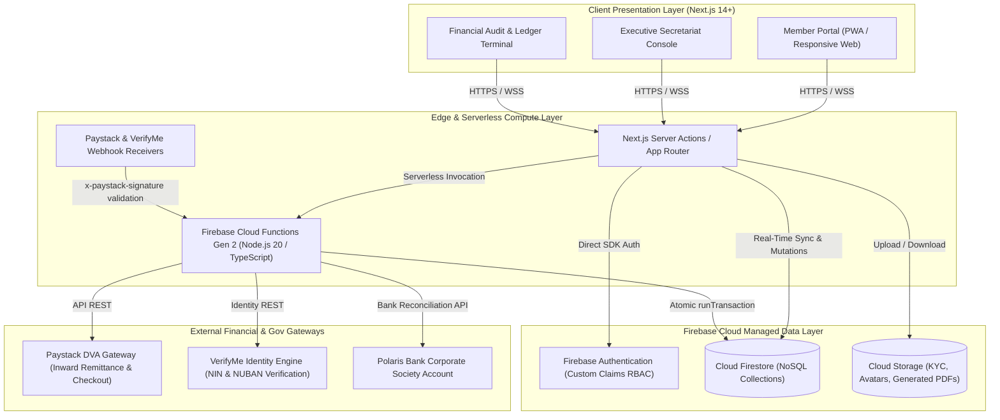
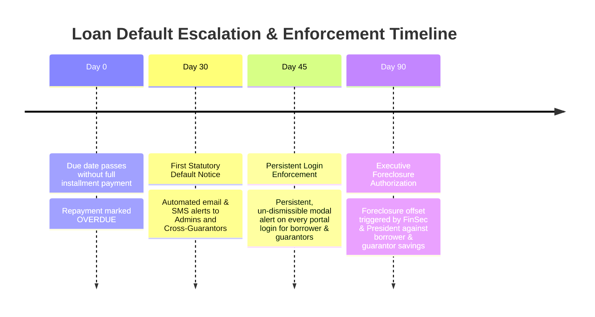
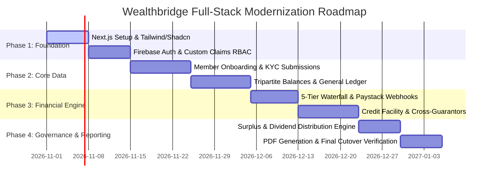

# WEALTHBRIDGE MULTIPURPOSE COOPERATIVE SOCIETY LIMITED (WMC)
# COMPREHENSIVE DEVELOPER HANDOVER & ARCHITECTURAL REWRITE BLUEPRINT
## Target Stack: Next.js 14+ (App Router, Server Actions) • Node.js / TypeScript • Firebase Cloud Functions Gen 2 • Firebase Firestore (NoSQL) • Firebase Storage

---

> **Document Status**: Final Architectural Master Blueprint (v2.0)  
> **Statutory Jurisdiction**: Lagos State Cooperative Societies Law (Cap C15)  
> **Official Secretariat Email**: `wealthbridge.coopsociety@gmail.com`  
> **Target Audience**: Incoming Full-Stack Engineer / Lead Architect specializing in NoSQL Data Architecture, Next.js, and Cloud Infrastructure  
> **Legacy Codebase Reference**: `c:\Users\Qadebowale\Desktop\The Official Corporators\WEALTHBRIDGE_WEB_APP`  

---

## TABLE OF CONTENTS
1. [Executive Architecture Overview & System Topology](#1-executive-architecture-overview--system-topology)
2. [Complete Relational Schema & Data Dictionary (39 MySQL Tables)](#2-complete-relational-schema--data-dictionary-39-mysql-tables)
3. [Relational-to-Firestore NoSQL Migration Blueprint](#3-relational-to-firestore-nosql-migration-blueprint)
4. [Core Business Logic, Statutory Invariants & Mathematical Formulas](#4-core-business-logic-statutory-invariants--mathematical-formulas)
5. [Complete API Endpoint Catalog & Server Actions Mapping (117 Endpoints)](#5-complete-api-endpoint-catalog--server-actions-mapping-117-endpoints)
6. [Dynamic RBAC & Security Matrix (35 Permissions, 10 Roles, Firestore Rules)](#6-dynamic-rbac--security-matrix-35-permissions-10-roles-firestore-rules)
7. [Third-Party Integrations & Webhook Handlers](#7-third-party-integrations--webhook-handlers)
8. [TypeScript / Node.js Reference Code & Transaction Snippets](#8-typescript--nodejs-reference-code--transaction-snippets)
9. [Phased Migration Roadmap & Verification Runbook](#9-phased-migration-roadmap--verification-runbook)

---

## 1. EXECUTIVE ARCHITECTURE OVERVIEW & SYSTEM TOPOLOGY

### 1.1 Organizational Context & Legal Mandate
Wealthbridge Multipurpose Cooperative Society Limited (**WMC**) is an autonomous, member-owned socioeconomic cooperative operating under the statutory authority of the **Lagos State Cooperative Societies Law (Cap C15)** and its officially ratified Bye-Laws. The cooperative provides ethical financial services, wealth building, cooperative loans (with zero compounding interest), target savings envelopes, welfare mutual aid, and pooled socioeconomic investments.

All official communication, letterheads, and system notifications must strictly maintain the primary contact invariant:
`wealthbridge.coopsociety@gmail.com`

### 1.2 Legacy Stack vs. Target Stack
The existing legacy platform was developed as a monolithic prototype using Python, FastAPI, and MySQL. While functionally complete, the cooperative is executing a full-stack architectural modernization to provide instantaneous reactive updates, cloud-native scalability, enterprise offline caching, and serverless reliability.

| Architectural Dimension | Legacy Implementation | Target Modernized Stack | Strategic Advantage |
|---|---|---|---|
| **Client Frontend** | Vanilla HTML5 / ES6 JavaScript / CSS3 / Jinja2 | **Next.js 14+ (App Router, React 18/19, TypeScript)** | Server Components, streaming SSR, type safety, component modularity |
| **Backend API** | Python 3.11+ / FastAPI / Uvicorn | **Next.js Server Actions & Route Handlers + Node.js 20+ Firebase Cloud Functions (Gen 2)** | Serverless elasticity, zero server management, sub-100ms cold starts |
| **Primary Database** | MySQL 8.0 (ACID Relational) | **Google Cloud Firestore (NoSQL Document Store)** | Native real-time listeners (`onSnapshot`), horizontal scaling, offline SDK |
| **Authentication & RBAC** | Custom session tokens / PBKDF2-HMAC-SHA256 | **Firebase Authentication + Custom Claims JWT** | Built-in MFA, biometric passkeys, cryptographic identity verification |
| **File / Media Storage** | Local Disk Filesystem (`/uploads`) | **Firebase Cloud Storage (Google Cloud Storage)** | Multi-region durability, fine-grained signed URLs, CDN delivery |
| **PDF Generation** | ReportLab 4.4 (Python) | **`@react-pdf/renderer` or Serverless `pdfkit`** | Direct React template rendering, pixel-perfect dynamic statements |
| **Styling & Design System** | Custom Vanilla CSS Stylesheets | **Tailwind CSS + Shadcn UI (Radix Primitives)** | Consistent design tokens, accessible components, dark/light theme |

### 1.3 High-Level System Topology Diagram



### 1.4 Non-Negotiable Cooperative Invariants
1. **Statutory Zero-Variance Double-Entry Balance**: In accordance with GAAP and statutory cooperative audit regulations, every financial transaction must be posted with zero variance:
   $$\sum 	ext{Debits} - \sum 	ext{Credits} = 	ext{₦}0.00$$
2. **Statutory 50.00% Reserve Retention**: In accordance with Lagos State Cooperative Societies Law (Cap C15) and WMC Bye-Laws Article 24, at least 50.00% of the Net Operating Surplus for every financial year must be irrevocably credited to the Statutory Reserve Fund (Account `3020`) before any dividend allocation pool is declared.
3. **Strict Priority Waterfall Remittance**: Every single inward remittance (via Paystack Dedicated Virtual Account, card payment, or verified bank teller) must strictly distribute funds according to the 5-tier waterfall hierarchy:
   $$	ext{Fines} \longrightarrow 	ext{₦5,000 Reg Fee} \longrightarrow 	ext{Loan Installment} \longrightarrow 	ext{₦2,000 Welfare} \longrightarrow 	ext{Savings / Shares}$$
4. **0.00% Compounding Interest Invariant**: Cooperative loans strictly charge **zero percent (0%)** compounding interest. A statutory flat 5.0% Administrative Cost Fee is levied once upon principal disbursement to cover regulatory oversight, credit insurance, and administrative management.
5. **2.0x Loan Collateralization Limit**: A member's maximum borrowing capacity cannot exceed two times (2.0x) their unencumbered liquid regular savings balance:
   $$	ext{Max Principal} \le 2.0 	imes 	ext{Available Unencumbered Savings}$$
6. **Cross-Guarantorship Lien Encumbrance**: A guarantor's committed guarantee amount is immediately placed as an active lien against their savings account, reducing their available unencumbered balance until the borrower amortizes the debt.
7. **Statutory Default & Escalation Schedule**:
   - **Day 30 Default**: Trigger instant push/email alerts to all Admins, borrower, and all cross-guarantors.
   - **Day 45 Default**: Trigger persistent, un-dismissible modal login warnings to borrower and all cross-guarantors upon every portal login.
   - **Day 90 Default**: Trigger Executive Foreclosure action prompts for Financial Secretary and President to offset delinquent debt against borrower regular savings and/or cross-guarantor encumbered balances.
8. **3-Month Arrears Auto-Suspension**: Any member with $\ge 3$ consecutive unpaid payment advices is automatically transitioned to `SUSPENDED` status. Suspended members retain portal access solely to view balances and make payments; clearance of all arrears automatically restores them to `ACTIVE`.
9. **30-Day Mandatory Cooling-Off Exit Notice**: Voluntary membership resignation requires a mandatory 30-day statutory notice period before equity liquidation and final settlement payout can occur.

---

## 2. COMPLETE RELATIONAL SCHEMA & DATA DICTIONARY (39 MYSQL TABLES)

Below is the complete, unabridged catalog of all 39 database tables in the MySQL system, grouped by functional domain. The incoming developer must use this data dictionary as the authoritative source of truth for all field names, data types, constraints, and business logic.

### Domain 1: Identity, Authentication & Secretariat Bio-Data

#### Table: `admin_users`
**Description**: System administrators and executive back-office operators with system credentials.

| Column Name | SQL Type | Nullable | Key | Default Value | Business Notes & Constraints |
|---|---|---|---|---|---|
| `id` | `int` | `NO` | `PRI` | `None` | Primary Key (Auto-increment integer ID) |
| `username` | `varchar(50)` | `NO` | `UNI` | `None` | Unique Constraint |
| `email` | `varchar(100)` | `NO` | `UNI` | `None` | Unique Constraint |
| `password_hash` | `varchar(255)` | `NO` | `` | `None` | - |
| `full_name` | `varchar(100)` | `NO` | `` | `None` | - |
| `role` | `varchar(50)` | `NO` | `` | `SUPER_ADMIN` | - |
| `is_active` | `tinyint(1)` | `YES` | `` | `1` | - |
| `created_at` | `timestamp` | `YES` | `` | `CURRENT_TIMESTAMP` | Record creation timestamp |
| `last_login` | `timestamp` | `YES` | `` | `None` | - |

#### Table: `members`
**Description**: Core cooperator registry containing biodata, contact details, KYC verification state, and membership status.

| Column Name | SQL Type | Nullable | Key | Default Value | Business Notes & Constraints |
|---|---|---|---|---|---|
| `id` | `int` | `NO` | `PRI` | `None` | Primary Key (Auto-increment integer ID) |
| `member_code` | `varchar(20)` | `NO` | `UNI` | `None` | Unique Constraint |
| `first_name` | `varchar(50)` | `NO` | `` | `None` | - |
| `last_name` | `varchar(50)` | `NO` | `` | `None` | - |
| `other_names` | `varchar(50)` | `YES` | `` | `None` | - |
| `email` | `varchar(100)` | `NO` | `UNI` | `None` | Unique Constraint |
| `password_hash` | `varchar(255)` | `YES` | `` | `None` | - |
| `phone` | `varchar(20)` | `NO` | `UNI` | `None` | Unique Constraint |
| `gender` | `enum('MALE','FEMALE')` | `NO` | `` | `None` | - |
| `marital_status` | `enum('SINGLE','MARRIED','DIVORCED','WIDOWED')` | `YES` | `` | `SINGLE` | Lifecycle state machine flag |
| `date_of_birth` | `date` | `YES` | `` | `None` | - |
| `residential_address` | `text` | `NO` | `` | `None` | - |
| `identification_type` | `enum('NIN','PASSPORT','VOTERS_CARD','DRIVERS_LICENSE')` | `NO` | `` | `None` | - |
| `identification_number` | `varchar(50)` | `NO` | `` | `None` | - |
| `passport_photo` | `longtext` | `YES` | `` | `None` | - |
| `employment_status` | `enum('SALARY_EARNER','BUSINESS_OWNER','PROFESSIONAL','OTHER')` | `NO` | `` | `None` | Lifecycle state machine flag |
| `employer_or_business_name` | `varchar(150)` | `YES` | `` | `None` | - |
| `bank_name` | `varchar(100)` | `YES` | `` | `None` | - |
| `bank_account_number` | `varchar(20)` | `YES` | `` | `None` | - |
| `bank_account_name` | `varchar(150)` | `YES` | `` | `None` | - |
| `bvn` | `varchar(20)` | `YES` | `` | `None` | - |
| `monthly_income_verified` | `decimal(15,2)` | `YES` | `` | `0.00` | - |
| `contribution_tier` | `enum('STANDARD','PLUS','PREMIUM')` | `YES` | `` | `STANDARD` | - |
| `dividend_payout_preference` | `enum('SAVINGS_CREDIT','BANK_TRANSFER')` | `YES` | `` | `SAVINGS_CREDIT` | - |
| `kyc_completion_percent` | `int` | `YES` | `` | `20` | - |
| `pending_email` | `varchar(100)` | `YES` | `` | `None` | - |
| `pending_phone` | `varchar(20)` | `YES` | `` | `None` | - |
| `pending_address` | `text` | `YES` | `` | `None` | - |
| `contact_change_status` | `enum('NONE','PENDING_APPROVAL','APPROVED','REJECTED')` | `YES` | `` | `NONE` | Lifecycle state machine flag |
| `contact_change_requested_at` | `datetime` | `YES` | `` | `None` | - |
| `contact_change_reviewed_by` | `int` | `YES` | `` | `None` | - |
| `contact_change_reviewed_at` | `datetime` | `YES` | `` | `None` | - |
| `status` | `enum('PENDING_KYC','ACTIVE','SUSPENDED','EXITED','DECEASED')` | `NO` | `MUL` | `PENDING_KYC` | Lifecycle state machine flag |
| `admission_date` | `date` | `YES` | `` | `None` | - |
| `exit_date` | `date` | `YES` | `` | `None` | - |
| `last_login` | `datetime` | `YES` | `` | `None` | - |
| `created_at` | `timestamp` | `YES` | `` | `CURRENT_TIMESTAMP` | Record creation timestamp |
| `updated_at` | `timestamp` | `YES` | `` | `CURRENT_TIMESTAMP` | Automated record update timestamp |
| `paystack_customer_code` | `varchar(100)` | `YES` | `` | `None` | - |
| `paystack_dva_account_number` | `varchar(20)` | `YES` | `` | `None` | - |
| `paystack_dva_bank_name` | `varchar(100)` | `YES` | `` | `None` | - |
| `paystack_dva_account_name` | `varchar(150)` | `YES` | `` | `None` | - |
| `paystack_auth_code` | `varchar(100)` | `YES` | `` | `None` | - |

#### Table: `next_of_kin`
**Description**: Designated beneficiaries for member equity and welfare benefits in event of demise or permanent incapacitation.

| Column Name | SQL Type | Nullable | Key | Default Value | Business Notes & Constraints |
|---|---|---|---|---|---|
| `id` | `int` | `NO` | `PRI` | `None` | Primary Key (Auto-increment integer ID) |
| `member_id` | `int` | `NO` | `MUL` | `None` | Foreign Key -> members(id) |
| `full_name` | `varchar(100)` | `NO` | `` | `None` | - |
| `relationship` | `varchar(50)` | `NO` | `` | `None` | - |
| `phone` | `varchar(20)` | `NO` | `` | `None` | - |
| `email` | `varchar(100)` | `YES` | `` | `None` | - |
| `residential_address` | `text` | `NO` | `` | `None` | - |
| `allocation_percentage` | `decimal(5,2)` | `YES` | `` | `100.00` | - |
| `created_at` | `timestamp` | `YES` | `` | `CURRENT_TIMESTAMP` | Record creation timestamp |
| `updated_at` | `timestamp` | `YES` | `` | `CURRENT_TIMESTAMP` | Automated record update timestamp |

#### Table: `officers`
**Description**: Elected executive committee members (President, Gen Sec, Fin Sec, Treasurer, Legal Lead) and their tenure terms.

| Column Name | SQL Type | Nullable | Key | Default Value | Business Notes & Constraints |
|---|---|---|---|---|---|
| `id` | `int` | `NO` | `PRI` | `None` | Primary Key (Auto-increment integer ID) |
| `member_id` | `int` | `NO` | `MUL` | `None` | Foreign Key -> members(id) |
| `portfolio` | `enum('PRESIDENT','VICE_PRESIDENT','GENERAL_SECRETARY','TREASURER','FINANCIAL_SECRETARY','LEGAL_COMPLIANCE_LEAD','TECHNOLOGY_SYSTEMS_LEAD','WELFARE_SECRETARY','PUBLIC_RELATIONS_OFFICER')` | `NO` | `` | `None` | - |
| `appointment_date` | `date` | `NO` | `` | `None` | - |
| `tenure_end_date` | `date` | `YES` | `` | `None` | - |
| `is_active` | `tinyint(1)` | `YES` | `` | `1` | - |
| `created_at` | `timestamp` | `YES` | `` | `CURRENT_TIMESTAMP` | Record creation timestamp |


### Domain 2: Dynamic RBAC & Permissions Engine

#### Table: `roles`
**Description**: Master RBAC role definitions, supporting both immutable statutory system roles and user-defined dynamic custom roles.

| Column Name | SQL Type | Nullable | Key | Default Value | Business Notes & Constraints |
|---|---|---|---|---|---|
| `id` | `int` | `NO` | `PRI` | `None` | Primary Key (Auto-increment integer ID) |
| `role_code` | `varchar(50)` | `NO` | `UNI` | `None` | Unique Constraint |
| `role_name` | `varchar(100)` | `NO` | `` | `None` | - |
| `description` | `text` | `YES` | `` | `None` | - |
| `is_system_role` | `tinyint(1)` | `YES` | `` | `0` | - |
| `created_at` | `timestamp` | `YES` | `` | `CURRENT_TIMESTAMP` | Record creation timestamp |

#### Table: `permissions`
**Description**: Granular capability flags across 8 cooperative operational modules.

| Column Name | SQL Type | Nullable | Key | Default Value | Business Notes & Constraints |
|---|---|---|---|---|---|
| `id` | `int` | `NO` | `PRI` | `None` | Primary Key (Auto-increment integer ID) |
| `perm_key` | `varchar(60)` | `NO` | `UNI` | `None` | Unique Constraint |
| `perm_name` | `varchar(120)` | `NO` | `` | `None` | - |
| `module` | `varchar(50)` | `NO` | `` | `None` | - |
| `description` | `text` | `YES` | `` | `None` | - |

#### Table: `role_permissions`
**Description**: Many-to-many junction binding granular permissions to specific roles.

| Column Name | SQL Type | Nullable | Key | Default Value | Business Notes & Constraints |
|---|---|---|---|---|---|
| `role_id` | `int` | `NO` | `PRI` | `None` | Primary Key (Auto-increment integer ID) |
| `permission_id` | `int` | `NO` | `PRI` | `None` | Primary Key (Auto-increment integer ID) |

#### Table: `member_roles`
**Description**: Junction table mapping members to multiple administrative roles with audit trails.

| Column Name | SQL Type | Nullable | Key | Default Value | Business Notes & Constraints |
|---|---|---|---|---|---|
| `id` | `int` | `NO` | `PRI` | `None` | Primary Key (Auto-increment integer ID) |
| `member_id` | `int` | `NO` | `MUL` | `None` | Foreign Key -> members(id) |
| `role_id` | `int` | `NO` | `MUL` | `None` | Foreign Key -> roles(id) |
| `assigned_by_user_id` | `int` | `YES` | `` | `None` | - |
| `assigned_at` | `timestamp` | `YES` | `` | `CURRENT_TIMESTAMP` | - |


### Domain 3: Tripartite Member Ledgers & Target Savings

#### Table: `savings_accounts`
**Description**: Member regular monthly savings balance, tracking total balance, encumbered lien, and available liquid balance.

| Column Name | SQL Type | Nullable | Key | Default Value | Business Notes & Constraints |
|---|---|---|---|---|---|
| `id` | `int` | `NO` | `PRI` | `None` | Primary Key (Auto-increment integer ID) |
| `member_id` | `int` | `NO` | `UNI` | `None` | Unique Constraint |
| `total_balance` | `decimal(15,2)` | `YES` | `` | `0.00` | Currency value stored with 2 decimal precision (kobo) |
| `encumbered_balance` | `decimal(15,2)` | `YES` | `` | `0.00` | Currency value stored with 2 decimal precision (kobo) |
| `available_balance` | `decimal(15,2)` | `YES` | `` | `None` | Currency value stored with 2 decimal precision (kobo) |
| `last_updated` | `timestamp` | `YES` | `` | `CURRENT_TIMESTAMP` | - |

#### Table: `share_accounts`
**Description**: Member equity share capital, tracking units held (₦1,000 par value), paid-up amount, and qualification threshold.

| Column Name | SQL Type | Nullable | Key | Default Value | Business Notes & Constraints |
|---|---|---|---|---|---|
| `id` | `int` | `NO` | `PRI` | `None` | Primary Key (Auto-increment integer ID) |
| `member_id` | `int` | `NO` | `UNI` | `None` | Unique Constraint |
| `units_held` | `int` | `YES` | `` | `0` | - |
| `paid_up_amount` | `decimal(15,2)` | `YES` | `` | `0.00` | Currency value stored with 2 decimal precision (kobo) |
| `is_minimum_met` | `tinyint(1)` | `YES` | `` | `0` | - |
| `benefits_qualified` | `tinyint(1)` | `YES` | `` | `0` | - |
| `last_updated` | `timestamp` | `YES` | `` | `CURRENT_TIMESTAMP` | - |

#### Table: `welfare_accounts`
**Description**: Member mutual health and bereavement welfare contributions and consecutive active months.

| Column Name | SQL Type | Nullable | Key | Default Value | Business Notes & Constraints |
|---|---|---|---|---|---|
| `id` | `int` | `NO` | `PRI` | `None` | Primary Key (Auto-increment integer ID) |
| `member_id` | `int` | `NO` | `UNI` | `None` | Unique Constraint |
| `cumulative_contributions` | `decimal(15,2)` | `YES` | `` | `0.00` | - |
| `consecutive_months_active` | `int` | `YES` | `` | `0` | - |
| `last_contribution_date` | `date` | `YES` | `` | `None` | - |
| `last_updated` | `timestamp` | `YES` | `` | `CURRENT_TIMESTAMP` | - |

#### Table: `target_savings_accounts`
**Description**: Purpose-driven savings envelopes (e.g. Asset Acquisition, Holiday, School Fees) with lock dates and target goals.

| Column Name | SQL Type | Nullable | Key | Default Value | Business Notes & Constraints |
|---|---|---|---|---|---|
| `id` | `int` | `NO` | `PRI` | `None` | Primary Key (Auto-increment integer ID) |
| `member_id` | `int` | `NO` | `MUL` | `None` | Foreign Key -> members(id) |
| `target_type` | `enum('BIRTHDAY','CHRISTMAS','ILEYA','BUILDING','PILGRIMAGE','EDUCATION','OTHERS')` | `NO` | `` | `None` | - |
| `title` | `varchar(150)` | `NO` | `` | `None` | - |
| `target_amount` | `decimal(15,2)` | `NO` | `` | `None` | Currency value stored with 2 decimal precision (kobo) |
| `current_balance` | `decimal(15,2)` | `NO` | `` | `0.00` | Currency value stored with 2 decimal precision (kobo) |
| `start_date` | `date` | `NO` | `` | `None` | - |
| `maturity_date` | `date` | `NO` | `` | `None` | - |
| `auto_save_amount` | `decimal(15,2)` | `YES` | `` | `0.00` | Currency value stored with 2 decimal precision (kobo) |
| `status` | `enum('ACTIVE','MATURED','WITHDRAWN','CANCELLED')` | `NO` | `` | `ACTIVE` | Lifecycle state machine flag |
| `created_at` | `timestamp` | `YES` | `` | `CURRENT_TIMESTAMP` | Record creation timestamp |
| `updated_at` | `timestamp` | `YES` | `` | `CURRENT_TIMESTAMP` | Automated record update timestamp |

#### Table: `target_savings_transactions`
**Description**: Audit ledger for deposits, withdrawals, and interest-free adjustments on target savings accounts.

| Column Name | SQL Type | Nullable | Key | Default Value | Business Notes & Constraints |
|---|---|---|---|---|---|
| `id` | `int` | `NO` | `PRI` | `None` | Primary Key (Auto-increment integer ID) |
| `target_account_id` | `int` | `NO` | `MUL` | `None` | - |
| `member_id` | `int` | `NO` | `MUL` | `None` | Foreign Key -> members(id) |
| `transaction_type` | `enum('DEPOSIT','WITHDRAWAL','INTEREST_DIVIDEND')` | `NO` | `` | `None` | - |
| `amount` | `decimal(15,2)` | `NO` | `` | `None` | Currency value stored with 2 decimal precision (kobo) |
| `balance_after` | `decimal(15,2)` | `NO` | `` | `None` | Currency value stored with 2 decimal precision (kobo) |
| `payment_method` | `varchar(50)` | `YES` | `` | `POLARIS_BANK_TRANSFER` | - |
| `channel_reference` | `varchar(100)` | `NO` | `` | `None` | - |
| `narration` | `text` | `YES` | `` | `None` | - |
| `created_at` | `timestamp` | `YES` | `` | `CURRENT_TIMESTAMP` | Record creation timestamp |

#### Table: `transactions`
**Description**: Universal cooperator passbook transaction ledger tracking all credit and debit movements.

| Column Name | SQL Type | Nullable | Key | Default Value | Business Notes & Constraints |
|---|---|---|---|---|---|
| `id` | `bigint` | `NO` | `PRI` | `None` | Primary Key (Auto-increment integer ID) |
| `transaction_ref` | `varchar(64)` | `NO` | `UNI` | `None` | Unique Constraint |
| `member_id` | `int` | `NO` | `MUL` | `None` | Foreign Key -> members(id) |
| `transaction_type` | `enum('CREDIT','DEBIT')` | `NO` | `MUL` | `None` | - |
| `ledger_category` | `enum('SAVINGS','SHARE_CAPITAL','WELFARE_FUND','REGISTRATION_FEE','PASSBOOK_FEE','LOAN_DISBURSEMENT','LOAN_REPAYMENT','WELFARE_GRANT','DISCIPLINARY_FINE','MARKETPLACE_SETTLEMENT')` | `NO` | `` | `None` | - |
| `amount` | `decimal(15,2)` | `NO` | `` | `None` | Currency value stored with 2 decimal precision (kobo) |
| `payment_method` | `enum('POLARIS_BANK_TRANSFER','DIRECT_DEBIT','ONLINE_GATEWAY','INTERNAL_SET_OFF')` | `NO` | `` | `None` | - |
| `channel_reference` | `varchar(100)` | `YES` | `` | `None` | - |
| `narration` | `varchar(255)` | `NO` | `` | `None` | - |
| `status` | `enum('PENDING','VERIFIED','REJECTED')` | `YES` | `` | `PENDING` | Lifecycle state machine flag |
| `verified_by_officer_id` | `int` | `YES` | `` | `None` | - |
| `transaction_date` | `datetime` | `YES` | `MUL` | `CURRENT_TIMESTAMP` | - |
| `created_at` | `timestamp` | `YES` | `` | `CURRENT_TIMESTAMP` | Record creation timestamp |


### Domain 4: Statutory Double-Entry Accounting Engine

#### Table: `chart_of_accounts`
**Description**: Standard statutory General Ledger Chart of Accounts classified under Assets, Liabilities, Equity, Revenue, and Expense.

| Column Name | SQL Type | Nullable | Key | Default Value | Business Notes & Constraints |
|---|---|---|---|---|---|
| `id` | `int` | `NO` | `PRI` | `None` | Primary Key (Auto-increment integer ID) |
| `account_code` | `varchar(16)` | `NO` | `UNI` | `None` | Unique Constraint |
| `account_name` | `varchar(128)` | `NO` | `` | `None` | - |
| `account_type` | `enum('ASSET','LIABILITY','EQUITY','INCOME','EXPENSE')` | `NO` | `` | `None` | - |
| `description` | `varchar(255)` | `YES` | `` | `None` | - |
| `is_active` | `tinyint(1)` | `YES` | `` | `1` | - |
| `is_system_controlled` | `tinyint(1)` | `YES` | `` | `1` | - |
| `created_at` | `timestamp` | `YES` | `` | `CURRENT_TIMESTAMP` | Record creation timestamp |

#### Table: `journal_entries`
**Description**: Auditable General Ledger double-entry transaction headers containing date, source module, and approval state.

| Column Name | SQL Type | Nullable | Key | Default Value | Business Notes & Constraints |
|---|---|---|---|---|---|
| `id` | `int` | `NO` | `PRI` | `None` | Primary Key (Auto-increment integer ID) |
| `entry_number` | `varchar(64)` | `NO` | `UNI` | `None` | Unique Constraint |
| `entry_date` | `date` | `NO` | `MUL` | `None` | - |
| `source_module` | `enum('REMITTANCE_WATERFALL','LOAN_DISBURSEMENT','LOAN_REPAYMENT','EXIT_SETTLEMENT','WELFARE_PAYOUT','DIVIDEND_DISTRIBUTION','MANUAL_JOURNAL','LOAN_FORECLOSURE')` | `NO` | `MUL` | `None` | - |
| `source_reference` | `varchar(128)` | `YES` | `` | `None` | - |
| `narration` | `text` | `NO` | `` | `None` | - |
| `total_debit` | `decimal(15,2)` | `NO` | `` | `None` | - |
| `total_credit` | `decimal(15,2)` | `NO` | `` | `None` | - |
| `is_balanced` | `tinyint(1)` | `YES` | `` | `1` | Currency value stored with 2 decimal precision (kobo) |
| `status` | `enum('DRAFT','POSTED','REJECTED')` | `YES` | `MUL` | `POSTED` | Lifecycle state machine flag |
| `created_by` | `int` | `YES` | `` | `None` | - |
| `approved_by` | `int` | `YES` | `` | `None` | - |
| `approved_at` | `timestamp` | `YES` | `` | `None` | - |
| `supporting_doc_url` | `varchar(255)` | `YES` | `` | `None` | - |
| `created_at` | `timestamp` | `YES` | `` | `CURRENT_TIMESTAMP` | Record creation timestamp |

#### Table: `journal_entry_lines`
**Description**: Individual debits and credits linked to journal entries enforcing zero-variance double-entry balance.

| Column Name | SQL Type | Nullable | Key | Default Value | Business Notes & Constraints |
|---|---|---|---|---|---|
| `id` | `int` | `NO` | `PRI` | `None` | Primary Key (Auto-increment integer ID) |
| `journal_entry_id` | `int` | `NO` | `MUL` | `None` | - |
| `account_id` | `int` | `NO` | `MUL` | `None` | - |
| `line_type` | `enum('DEBIT','CREDIT')` | `NO` | `MUL` | `None` | - |
| `amount` | `decimal(15,2)` | `NO` | `` | `None` | Currency value stored with 2 decimal precision (kobo) |
| `memo` | `varchar(255)` | `YES` | `` | `None` | - |
| `created_at` | `timestamp` | `YES` | `` | `CURRENT_TIMESTAMP` | Record creation timestamp |


### Domain 5: Inward Remittances, Payment Advices & Waterfalls

#### Table: `payment_advices`
**Description**: Monthly itemized billing advice generated for each active cooperator detailing expected monthly remittances.

| Column Name | SQL Type | Nullable | Key | Default Value | Business Notes & Constraints |
|---|---|---|---|---|---|
| `id` | `int` | `NO` | `PRI` | `None` | Primary Key (Auto-increment integer ID) |
| `advice_reference` | `varchar(64)` | `NO` | `UNI` | `None` | Unique Constraint |
| `member_id` | `int` | `NO` | `MUL` | `None` | Foreign Key -> members(id) |
| `billing_period` | `varchar(7)` | `NO` | `` | `None` | - |
| `issue_date` | `date` | `NO` | `` | `None` | - |
| `due_date` | `date` | `NO` | `` | `None` | - |
| `tier_at_issuance` | `enum('STANDARD','PLUS','PREMIUM')` | `NO` | `` | `STANDARD` | - |
| `amount_fines` | `decimal(12,2)` | `NO` | `` | `0.00` | Currency value stored with 2 decimal precision (kobo) |
| `amount_registration_fee` | `decimal(15,2)` | `NO` | `` | `0.00` | Currency value stored with 2 decimal precision (kobo) |
| `amount_loan_repayment` | `decimal(12,2)` | `NO` | `` | `0.00` | Currency value stored with 2 decimal precision (kobo) |
| `amount_welfare` | `decimal(12,2)` | `NO` | `` | `0.00` | Currency value stored with 2 decimal precision (kobo) |
| `amount_share_capital` | `decimal(12,2)` | `NO` | `` | `0.00` | Currency value stored with 2 decimal precision (kobo) |
| `amount_regular_savings` | `decimal(12,2)` | `NO` | `` | `0.00` | Currency value stored with 2 decimal precision (kobo) |
| `amount_target_savings` | `decimal(12,2)` | `NO` | `` | `0.00` | Currency value stored with 2 decimal precision (kobo) |
| `amount_arrears` | `decimal(12,2)` | `NO` | `` | `0.00` | Currency value stored with 2 decimal precision (kobo) |
| `total_expected_amount` | `decimal(12,2)` | `NO` | `` | `0.00` | Currency value stored with 2 decimal precision (kobo) |
| `paid_fines` | `decimal(12,2)` | `NO` | `` | `0.00` | - |
| `paid_registration` | `decimal(15,2)` | `NO` | `` | `0.00` | - |
| `paid_loan` | `decimal(12,2)` | `NO` | `` | `0.00` | - |
| `paid_welfare` | `decimal(12,2)` | `NO` | `` | `0.00` | - |
| `paid_shares` | `decimal(12,2)` | `NO` | `` | `0.00` | - |
| `paid_savings` | `decimal(12,2)` | `NO` | `` | `0.00` | - |
| `paid_targets` | `decimal(12,2)` | `NO` | `` | `0.00` | - |
| `total_amount_paid` | `decimal(12,2)` | `NO` | `` | `0.00` | Currency value stored with 2 decimal precision (kobo) |
| `outstanding_balance` | `decimal(12,2)` | `NO` | `` | `0.00` | Currency value stored with 2 decimal precision (kobo) |
| `status` | `enum('DUE','PARTIALLY_PAID','FULLY_SETTLED','OVERDUE')` | `NO` | `MUL` | `DUE` | Lifecycle state machine flag |
| `admin_notes` | `text` | `YES` | `` | `None` | - |
| `created_at` | `timestamp` | `YES` | `` | `CURRENT_TIMESTAMP` | Record creation timestamp |
| `updated_at` | `timestamp` | `YES` | `` | `CURRENT_TIMESTAMP` | Automated record update timestamp |

#### Table: `payment_advice_distributions`
**Description**: Waterfall distribution ledger recording the exact breakdown of inward payments across liabilities.

| Column Name | SQL Type | Nullable | Key | Default Value | Business Notes & Constraints |
|---|---|---|---|---|---|
| `id` | `int` | `NO` | `PRI` | `None` | Primary Key (Auto-increment integer ID) |
| `advice_id` | `int` | `NO` | `MUL` | `None` | Foreign Key -> payment_advices(id) |
| `member_id` | `int` | `NO` | `MUL` | `None` | Foreign Key -> members(id) |
| `payment_reference` | `varchar(128)` | `NO` | `MUL` | `None` | - |
| `payment_method` | `varchar(64)` | `NO` | `` | `PAYSTACK_DVA` | - |
| `total_payment_received` | `decimal(12,2)` | `NO` | `` | `0.00` | - |
| `allocated_fines` | `decimal(12,2)` | `NO` | `` | `0.00` | - |
| `allocated_registration` | `decimal(15,2)` | `YES` | `` | `0.00` | - |
| `allocated_loan` | `decimal(12,2)` | `NO` | `` | `0.00` | - |
| `allocated_welfare` | `decimal(12,2)` | `NO` | `` | `0.00` | - |
| `allocated_shares` | `decimal(12,2)` | `NO` | `` | `0.00` | - |
| `allocated_savings` | `decimal(12,2)` | `NO` | `` | `0.00` | - |
| `allocated_targets` | `decimal(12,2)` | `NO` | `` | `0.00` | - |
| `allocated_surplus_savings` | `decimal(12,2)` | `NO` | `` | `0.00` | - |
| `narration` | `varchar(255)` | `YES` | `` | `None` | - |
| `created_at` | `timestamp` | `YES` | `` | `CURRENT_TIMESTAMP` | Record creation timestamp |

#### Table: `manual_bank_payments`
**Description**: Direct member bank transfers and teller deposit receipts pending secretariat verification.

| Column Name | SQL Type | Nullable | Key | Default Value | Business Notes & Constraints |
|---|---|---|---|---|---|
| `id` | `bigint` | `NO` | `PRI` | `None` | Primary Key (Auto-increment integer ID) |
| `member_id` | `int` | `NO` | `MUL` | `None` | Foreign Key -> members(id) |
| `amount` | `decimal(15,2)` | `NO` | `` | `None` | Currency value stored with 2 decimal precision (kobo) |
| `payment_date` | `date` | `NO` | `` | `None` | - |
| `bank_name` | `varchar(100)` | `YES` | `` | `Polaris Bank Limited` | - |
| `payment_reference` | `varchar(100)` | `NO` | `` | `None` | - |
| `narration` | `varchar(255)` | `YES` | `` | `None` | - |
| `receipt_file_path` | `varchar(255)` | `YES` | `` | `None` | - |
| `receipt_mime_type` | `varchar(80)` | `YES` | `` | `None` | - |
| `status` | `varchar(32)` | `NO` | `MUL` | `PENDING_RECONCILIATION` | Lifecycle state machine flag |
| `verified_by_officer_id` | `int` | `YES` | `` | `None` | - |
| `verified_at` | `datetime` | `YES` | `` | `None` | - |
| `rejection_reason` | `varchar(255)` | `YES` | `` | `None` | - |
| `distribution_json` | `json` | `YES` | `` | `None` | - |
| `created_at` | `timestamp` | `YES` | `` | `CURRENT_TIMESTAMP` | Record creation timestamp |

#### Table: `paystack_webhook_logs`
**Description**: Raw audit log of all inbound webhook events received from the Paystack payment gateway.

| Column Name | SQL Type | Nullable | Key | Default Value | Business Notes & Constraints |
|---|---|---|---|---|---|
| `id` | `int` | `NO` | `PRI` | `None` | Primary Key (Auto-increment integer ID) |
| `event_type` | `varchar(100)` | `NO` | `` | `None` | - |
| `reference` | `varchar(100)` | `NO` | `UNI` | `None` | Unique Constraint |
| `member_id` | `int` | `YES` | `MUL` | `None` | Foreign Key -> members(id) |
| `amount` | `decimal(15,2)` | `NO` | `` | `None` | Currency value stored with 2 decimal precision (kobo) |
| `channel` | `varchar(50)` | `YES` | `` | `dedicated_nuban` | - |
| `payload` | `json` | `NO` | `` | `None` | - |
| `status` | `enum('PROCESSED','IGNORED','FAILED')` | `YES` | `` | `PROCESSED` | Lifecycle state machine flag |
| `created_at` | `timestamp` | `YES` | `` | `CURRENT_TIMESTAMP` | Record creation timestamp |


### Domain 6: Credit Facility, Statutory Loans & Guarantorship

#### Table: `loan_products`
**Description**: Configurable credit products establishing borrowing multipliers, tenures, and administrative fee rates.

| Column Name | SQL Type | Nullable | Key | Default Value | Business Notes & Constraints |
|---|---|---|---|---|---|
| `id` | `int` | `NO` | `PRI` | `None` | Primary Key (Auto-increment integer ID) |
| `product_name` | `varchar(100)` | `NO` | `` | `None` | - |
| `product_code` | `varchar(30)` | `NO` | `UNI` | `None` | Unique Constraint |
| `description` | `text` | `YES` | `` | `None` | - |
| `min_membership_months` | `int` | `YES` | `` | `6` | - |
| `max_multiplier_of_savings` | `decimal(3,1)` | `YES` | `` | `2.0` | - |
| `max_principal_ceiling` | `decimal(15,2)` | `NO` | `` | `None` | - |
| `admin_cost_fee_percent` | `decimal(5,2)` | `NO` | `` | `None` | Currency value stored with 2 decimal precision (kobo) |
| `min_tenure_months` | `int` | `YES` | `` | `1` | - |
| `max_tenure_months` | `int` | `YES` | `` | `12` | - |
| `is_active` | `tinyint(1)` | `YES` | `` | `1` | - |
| `created_at` | `timestamp` | `YES` | `` | `CURRENT_TIMESTAMP` | Record creation timestamp |

#### Table: `loans`
**Description**: Statutory cooperative loan applications, approved facilities, active amortizations, and repayment schedules.

| Column Name | SQL Type | Nullable | Key | Default Value | Business Notes & Constraints |
|---|---|---|---|---|---|
| `id` | `int` | `NO` | `PRI` | `None` | Primary Key (Auto-increment integer ID) |
| `loan_reference` | `varchar(50)` | `NO` | `UNI` | `None` | Unique Constraint |
| `member_id` | `int` | `NO` | `MUL` | `None` | Foreign Key -> members(id) |
| `product_id` | `int` | `NO` | `MUL` | `None` | - |
| `principal_amount` | `decimal(15,2)` | `NO` | `` | `None` | Currency value stored with 2 decimal precision (kobo) |
| `admin_cost_fee` | `decimal(15,2)` | `NO` | `` | `None` | Currency value stored with 2 decimal precision (kobo) |
| `total_amount_payable` | `decimal(15,2)` | `NO` | `` | `None` | Currency value stored with 2 decimal precision (kobo) |
| `tenure_months` | `int` | `NO` | `` | `None` | - |
| `monthly_installment` | `decimal(15,2)` | `NO` | `` | `None` | - |
| `total_paid` | `decimal(15,2)` | `YES` | `` | `0.00` | - |
| `outstanding_balance` | `decimal(15,2)` | `NO` | `` | `None` | Currency value stored with 2 decimal precision (kobo) |
| `status` | `varchar(32)` | `NO` | `MUL` | `PENDING` | Lifecycle state machine flag |
| `application_date` | `date` | `NO` | `` | `None` | - |
| `approval_date` | `date` | `YES` | `` | `None` | - |
| `disbursement_date` | `date` | `YES` | `` | `None` | - |
| `next_due_date` | `date` | `YES` | `` | `None` | - |
| `maturity_date` | `date` | `YES` | `` | `None` | - |
| `created_at` | `timestamp` | `YES` | `` | `CURRENT_TIMESTAMP` | Record creation timestamp |
| `updated_at` | `timestamp` | `YES` | `` | `CURRENT_TIMESTAMP` | Automated record update timestamp |
| `approval_level_percent` | `int` | `YES` | `` | `0` | - |
| `current_approval_stage` | `varchar(40)` | `YES` | `` | `CREDIT_COMMITTEE` | - |
| `presidential_override` | `tinyint(1)` | `YES` | `` | `0` | - |
| `decline_reason` | `text` | `YES` | `` | `None` | - |
| `declined_by_officer_id` | `int` | `YES` | `` | `None` | - |
| `declined_by_role` | `varchar(50)` | `YES` | `` | `None` | - |
| `purpose_narration` | `text` | `YES` | `` | `None` | - |

#### Table: `loan_approval_steps`
**Description**: Multi-stage sequential approval workflow records (Secretariat -> Credit Committee -> President Sign-off).

| Column Name | SQL Type | Nullable | Key | Default Value | Business Notes & Constraints |
|---|---|---|---|---|---|
| `id` | `bigint` | `NO` | `PRI` | `None` | Primary Key (Auto-increment integer ID) |
| `loan_id` | `int` | `NO` | `MUL` | `None` | Foreign Key -> loans(id) |
| `step_name` | `varchar(50)` | `NO` | `` | `None` | - |
| `officer_id` | `int` | `NO` | `` | `None` | - |
| `officer_role` | `varchar(80)` | `NO` | `` | `None` | - |
| `action` | `enum('APPROVED','DECLINED','OVERRIDDEN')` | `NO` | `` | `None` | - |
| `comments` | `text` | `YES` | `` | `None` | - |
| `percentage_granted` | `int` | `NO` | `` | `None` | - |
| `created_at` | `timestamp` | `YES` | `` | `CURRENT_TIMESTAMP` | Record creation timestamp |

#### Table: `loan_guarantors`
**Description**: Cross-guarantor commitments binding fellow cooperators' savings as collateral for a borrower's facility.

| Column Name | SQL Type | Nullable | Key | Default Value | Business Notes & Constraints |
|---|---|---|---|---|---|
| `id` | `int` | `NO` | `PRI` | `None` | Primary Key (Auto-increment integer ID) |
| `loan_id` | `int` | `NO` | `MUL` | `None` | Foreign Key -> loans(id) |
| `guarantor_member_id` | `int` | `NO` | `MUL` | `None` | Foreign Key -> members(id) |
| `guaranteed_amount` | `decimal(15,2)` | `NO` | `` | `None` | Currency value stored with 2 decimal precision (kobo) |
| `lien_encumbered_amount` | `decimal(15,2)` | `NO` | `` | `0.00` | Currency value stored with 2 decimal precision (kobo) |
| `status` | `enum('PENDING_CONSENT','ACCEPTED','DECLINED','RELEASED','INVOKED')` | `NO` | `` | `PENDING_CONSENT` | Lifecycle state machine flag |
| `accepted_at` | `datetime` | `YES` | `` | `None` | - |
| `released_at` | `datetime` | `YES` | `` | `None` | - |

#### Table: `loan_repayments`
**Description**: Amortized monthly installment schedules, tracking due dates, amount due, and paid status.

| Column Name | SQL Type | Nullable | Key | Default Value | Business Notes & Constraints |
|---|---|---|---|---|---|
| `id` | `bigint` | `NO` | `PRI` | `None` | Primary Key (Auto-increment integer ID) |
| `loan_id` | `int` | `NO` | `MUL` | `None` | Foreign Key -> loans(id) |
| `installment_number` | `int` | `NO` | `` | `None` | - |
| `due_date` | `date` | `NO` | `` | `None` | - |
| `amount_due` | `decimal(15,2)` | `NO` | `` | `None` | Currency value stored with 2 decimal precision (kobo) |
| `amount_paid` | `decimal(15,2)` | `YES` | `` | `0.00` | Currency value stored with 2 decimal precision (kobo) |
| `paid_date` | `datetime` | `YES` | `` | `None` | - |
| `transaction_ref` | `varchar(64)` | `YES` | `` | `None` | - |
| `status` | `enum('PENDING','PARTIAL','PAID','OVERDUE')` | `YES` | `` | `PENDING` | Lifecycle state machine flag |

#### Table: `loan_appeals`
**Description**: Formal dispute and reconsideration requests submitted by members whose loan applications were declined.

| Column Name | SQL Type | Nullable | Key | Default Value | Business Notes & Constraints |
|---|---|---|---|---|---|
| `id` | `bigint` | `NO` | `PRI` | `None` | Primary Key (Auto-increment integer ID) |
| `loan_id` | `int` | `NO` | `MUL` | `None` | Foreign Key -> loans(id) |
| `member_id` | `int` | `NO` | `MUL` | `None` | Foreign Key -> members(id) |
| `appeal_comments` | `text` | `NO` | `` | `None` | - |
| `attached_document_path` | `varchar(255)` | `YES` | `` | `None` | - |
| `document_name` | `varchar(150)` | `YES` | `` | `None` | - |
| `document_mime_type` | `varchar(80)` | `YES` | `` | `None` | - |
| `target_officer_id` | `int` | `YES` | `` | `None` | - |
| `status` | `varchar(32)` | `NO` | `` | `PENDING_REVIEW` | Lifecycle state machine flag |
| `review_response` | `text` | `YES` | `` | `None` | - |
| `created_at` | `timestamp` | `YES` | `` | `CURRENT_TIMESTAMP` | Record creation timestamp |
| `resolved_at` | `datetime` | `YES` | `` | `None` | - |


### Domain 7: Cooperative Governance, Attendance & Member Exits

#### Table: `general_meetings`
**Description**: Official Annual General Meetings (AGM) and Extraordinary General Meetings (EGM) convening logs.

| Column Name | SQL Type | Nullable | Key | Default Value | Business Notes & Constraints |
|---|---|---|---|---|---|
| `id` | `int` | `NO` | `PRI` | `None` | Primary Key (Auto-increment integer ID) |
| `meeting_type` | `enum('ANNUAL_GENERAL_MEETING','SPECIAL_GENERAL_MEETING','MONTHLY_EXECUTIVE')` | `NO` | `` | `None` | - |
| `meeting_title` | `varchar(150)` | `NO` | `` | `None` | - |
| `meeting_date` | `date` | `NO` | `` | `None` | - |
| `minute_reference_doc` | `varchar(255)` | `YES` | `` | `None` | - |
| `created_at` | `timestamp` | `YES` | `` | `CURRENT_TIMESTAMP` | Record creation timestamp |

#### Table: `meeting_attendance`
**Description**: Attendance roll-call tracking member quorum, physical/virtual presence, and apologies.

| Column Name | SQL Type | Nullable | Key | Default Value | Business Notes & Constraints |
|---|---|---|---|---|---|
| `id` | `bigint` | `NO` | `PRI` | `None` | Primary Key (Auto-increment integer ID) |
| `meeting_id` | `int` | `NO` | `MUL` | `None` | - |
| `member_id` | `int` | `NO` | `MUL` | `None` | Foreign Key -> members(id) |
| `attendance_status` | `enum('PRESENT','ABSENT_WITH_APOLOGY','ABSENT_WITHOUT_APOLOGY')` | `NO` | `` | `None` | Lifecycle state machine flag |
| `arrival_time` | `time` | `YES` | `` | `None` | - |

#### Table: `disciplinary_fines`
**Description**: Statutory punitive fines levied for meeting absenteeism, policy breaches, or late compliance.

| Column Name | SQL Type | Nullable | Key | Default Value | Business Notes & Constraints |
|---|---|---|---|---|---|
| `id` | `int` | `NO` | `PRI` | `None` | Primary Key (Auto-increment integer ID) |
| `member_id` | `int` | `NO` | `MUL` | `None` | Foreign Key -> members(id) |
| `infraction_type` | `enum('LATE_MONTHLY_REMITTANCE','MEETING_ABSENTEEISM','MEETING_LATENESS','UNAUTHORIZED_REPRESENTATION','CODE_OF_CONDUCT_BREACH')` | `NO` | `` | `None` | - |
| `fine_amount` | `decimal(15,2)` | `NO` | `` | `None` | Currency value stored with 2 decimal precision (kobo) |
| `reason` | `text` | `NO` | `` | `None` | - |
| `status` | `enum('UNPAID','SETTLED','WAIVED')` | `YES` | `` | `UNPAID` | Lifecycle state machine flag |
| `issued_date` | `date` | `NO` | `` | `None` | - |
| `settled_date` | `date` | `YES` | `` | `None` | - |
| `created_at` | `timestamp` | `YES` | `` | `CURRENT_TIMESTAMP` | Record creation timestamp |

#### Table: `member_exits`
**Description**: Voluntary and statutory membership termination records, managing 30-day notice and equity liquidation.

| Column Name | SQL Type | Nullable | Key | Default Value | Business Notes & Constraints |
|---|---|---|---|---|---|
| `id` | `int` | `NO` | `PRI` | `None` | Primary Key (Auto-increment integer ID) |
| `member_id` | `int` | `NO` | `MUL` | `None` | Foreign Key -> members(id) |
| `exit_type` | `enum('VOLUNTARY_WITHDRAWAL','DEATH_ESTATE_SETTLEMENT','EXPULSION')` | `NO` | `MUL` | `VOLUNTARY_WITHDRAWAL` | - |
| `notice_date` | `date` | `NO` | `` | `None` | - |
| `statutory_notice_expiry_date` | `date` | `NO` | `` | `None` | - |
| `reason` | `text` | `YES` | `` | `None` | - |
| `supporting_doc_url` | `varchar(500)` | `YES` | `` | `None` | - |
| `nok_claimant_name` | `varchar(150)` | `YES` | `` | `None` | - |
| `nok_claimant_phone` | `varchar(30)` | `YES` | `` | `None` | - |
| `nok_relationship` | `varchar(50)` | `YES` | `` | `None` | - |
| `status` | `enum('PENDING_CLEARANCE','FINANCIALLY_CLEARED','SETTLED_REFUNDED','REJECTED')` | `NO` | `MUL` | `PENDING_CLEARANCE` | Lifecycle state machine flag |
| `total_savings_at_exit` | `decimal(15,2)` | `NO` | `` | `0.00` | - |
| `total_target_savings_at_exit` | `decimal(15,2)` | `NO` | `` | `0.00` | - |
| `total_shares_at_exit` | `decimal(15,2)` | `NO` | `` | `0.00` | - |
| `outstanding_loans_at_exit` | `decimal(15,2)` | `NO` | `` | `0.00` | - |
| `outstanding_fines_at_exit` | `decimal(15,2)` | `NO` | `` | `0.00` | - |
| `active_guarantor_commitments_count` | `int` | `NO` | `` | `0` | - |
| `exit_processing_fee` | `decimal(15,2)` | `NO` | `` | `0.00` | Currency value stored with 2 decimal precision (kobo) |
| `bereavement_welfare_grant` | `decimal(15,2)` | `NO` | `` | `0.00` | - |
| `net_refund_amount` | `decimal(15,2)` | `NO` | `` | `0.00` | Currency value stored with 2 decimal precision (kobo) |
| `cleared_by_officer_id` | `int` | `YES` | `` | `None` | - |
| `approved_by_president_id` | `int` | `YES` | `` | `None` | - |
| `rejection_reason` | `text` | `YES` | `` | `None` | - |
| `refund_payment_ref` | `varchar(100)` | `YES` | `` | `None` | - |
| `refund_disbursed_at` | `datetime` | `YES` | `` | `None` | - |
| `created_at` | `datetime` | `NO` | `` | `CURRENT_TIMESTAMP` | Record creation timestamp |
| `updated_at` | `datetime` | `NO` | `` | `CURRENT_TIMESTAMP` | Automated record update timestamp |


### Domain 8: Surplus Allocation & Dividend Distribution Engine

#### Table: `dividend_periods`
**Description**: Annual financial surplus allocation periods capturing net surplus, 50% statutory reserve, and distributable pool.

| Column Name | SQL Type | Nullable | Key | Default Value | Business Notes & Constraints |
|---|---|---|---|---|---|
| `id` | `int` | `NO` | `PRI` | `None` | Primary Key (Auto-increment integer ID) |
| `period_name` | `varchar(64)` | `NO` | `` | `None` | - |
| `financial_year_start` | `date` | `NO` | `` | `None` | - |
| `financial_year_end` | `date` | `NO` | `` | `None` | - |
| `net_surplus_amount` | `decimal(15,2)` | `NO` | `` | `None` | Currency value stored with 2 decimal precision (kobo) |
| `statutory_reserve_percent` | `decimal(5,2)` | `YES` | `` | `50.00` | - |
| `statutory_reserve_amount` | `decimal(15,2)` | `NO` | `` | `None` | Currency value stored with 2 decimal precision (kobo) |
| `distributable_pool_amount` | `decimal(15,2)` | `NO` | `` | `None` | Currency value stored with 2 decimal precision (kobo) |
| `weight_share_capital_percent` | `decimal(5,2)` | `YES` | `` | `60.00` | - |
| `weight_savings_volume_percent` | `decimal(5,2)` | `YES` | `` | `40.00` | - |
| `weight_patronage_percent` | `decimal(5,2)` | `YES` | `` | `0.00` | - |
| `min_share_units_required` | `int` | `YES` | `` | `5` | - |
| `min_active_months_required` | `int` | `YES` | `` | `6` | - |
| `disqualify_active_arrears` | `tinyint(1)` | `YES` | `` | `1` | - |
| `total_qualified_members` | `int` | `YES` | `` | `0` | - |
| `total_disqualified_members` | `int` | `YES` | `` | `0` | - |
| `status` | `enum('DRAFT_SIMULATION','AUDIT_REVIEW','APPROVED_POSTED','CANCELLED')` | `YES` | `` | `DRAFT_SIMULATION` | Lifecycle state machine flag |
| `simulated_by_user_id` | `int` | `YES` | `` | `None` | - |
| `approved_by_president_id` | `int` | `YES` | `` | `None` | - |
| `approved_at` | `timestamp` | `YES` | `` | `None` | - |
| `created_at` | `timestamp` | `YES` | `` | `CURRENT_TIMESTAMP` | Record creation timestamp |

#### Table: `dividend_allocations`
**Description**: Member-by-member dividend payouts calculated on shares, savings, and loan patronage rebate.

| Column Name | SQL Type | Nullable | Key | Default Value | Business Notes & Constraints |
|---|---|---|---|---|---|
| `id` | `int` | `NO` | `PRI` | `None` | Primary Key (Auto-increment integer ID) |
| `dividend_period_id` | `int` | `NO` | `MUL` | `None` | - |
| `member_id` | `int` | `NO` | `MUL` | `None` | Foreign Key -> members(id) |
| `shares_held` | `int` | `NO` | `` | `None` | - |
| `share_equity_amount` | `decimal(15,2)` | `NO` | `` | `None` | Currency value stored with 2 decimal precision (kobo) |
| `savings_balance` | `decimal(15,2)` | `NO` | `` | `None` | Currency value stored with 2 decimal precision (kobo) |
| `loan_patronage_volume` | `decimal(15,2)` | `YES` | `` | `0.00` | - |
| `is_qualified` | `tinyint(1)` | `NO` | `` | `None` | - |
| `disqualification_reason` | `varchar(255)` | `YES` | `` | `None` | - |
| `dividend_from_shares` | `decimal(15,2)` | `YES` | `` | `0.00` | - |
| `dividend_from_savings` | `decimal(15,2)` | `YES` | `` | `0.00` | - |
| `dividend_from_patronage` | `decimal(15,2)` | `YES` | `` | `0.00` | - |
| `total_dividend_payable` | `decimal(15,2)` | `NO` | `` | `None` | - |
| `payout_preference` | `enum('SAVINGS_CREDIT','BANK_TRANSFER')` | `YES` | `` | `SAVINGS_CREDIT` | - |
| `payout_status` | `enum('PENDING','CREDITED_TO_SAVINGS','DISBURSED_TO_BANK')` | `YES` | `MUL` | `PENDING` | Lifecycle state machine flag |
| `payout_reference` | `varchar(128)` | `YES` | `` | `None` | - |
| `settled_at` | `timestamp` | `YES` | `` | `None` | - |
| `created_at` | `timestamp` | `YES` | `` | `CURRENT_TIMESTAMP` | Record creation timestamp |


### Domain 9: Cooperative Marketplace & Notifications Infrastructure

#### Table: `marketplace_merchants`
**Description**: Vetted cooperator-owned businesses authorized to list goods and services on the cooperative exchange.

| Column Name | SQL Type | Nullable | Key | Default Value | Business Notes & Constraints |
|---|---|---|---|---|---|
| `id` | `int` | `NO` | `PRI` | `None` | Primary Key (Auto-increment integer ID) |
| `member_id` | `int` | `NO` | `UNI` | `None` | Unique Constraint |
| `business_trading_name` | `varchar(150)` | `NO` | `` | `None` | - |
| `category` | `varchar(100)` | `NO` | `` | `None` | - |
| `status` | `enum('PENDING_APPROVAL','APPROVED','SUSPENDED')` | `YES` | `` | `PENDING_APPROVAL` | Lifecycle state machine flag |
| `registered_at` | `timestamp` | `YES` | `` | `CURRENT_TIMESTAMP` | - |

#### Table: `marketplace_products`
**Description**: Goods and services listed by merchant cooperators, with cooperative asset-financing flags.

| Column Name | SQL Type | Nullable | Key | Default Value | Business Notes & Constraints |
|---|---|---|---|---|---|
| `id` | `int` | `NO` | `PRI` | `None` | Primary Key (Auto-increment integer ID) |
| `merchant_id` | `int` | `NO` | `MUL` | `None` | - |
| `product_title` | `varchar(150)` | `NO` | `` | `None` | - |
| `description` | `text` | `YES` | `` | `None` | - |
| `price` | `decimal(15,2)` | `NO` | `` | `None` | - |
| `is_financing_eligible` | `tinyint(1)` | `YES` | `` | `1` | - |
| `stock_quantity` | `int` | `YES` | `` | `0` | - |
| `is_active` | `tinyint(1)` | `YES` | `` | `1` | - |
| `created_at` | `timestamp` | `YES` | `` | `CURRENT_TIMESTAMP` | Record creation timestamp |

#### Table: `system_config`
**Description**: Dynamic key-value system parameters (e.g. minimum shares, registration fee, default escalation thresholds).

| Column Name | SQL Type | Nullable | Key | Default Value | Business Notes & Constraints |
|---|---|---|---|---|---|
| `id` | `int` | `NO` | `PRI` | `None` | Primary Key (Auto-increment integer ID) |
| `config_key` | `varchar(64)` | `NO` | `UNI` | `None` | Unique Constraint |
| `config_value` | `varchar(255)` | `NO` | `` | `None` | - |
| `description` | `varchar(255)` | `YES` | `` | `None` | - |
| `updated_at` | `timestamp` | `YES` | `` | `CURRENT_TIMESTAMP` | Automated record update timestamp |

#### Table: `system_notifications`
**Description**: Targeted push and portal notifications delivered to members and executive officers.

| Column Name | SQL Type | Nullable | Key | Default Value | Business Notes & Constraints |
|---|---|---|---|---|---|
| `id` | `int` | `NO` | `PRI` | `None` | Primary Key (Auto-increment integer ID) |
| `recipient_type` | `enum('MEMBER','OFFICER','ALL_ADMIN')` | `NO` | `MUL` | `None` | - |
| `recipient_id` | `int` | `YES` | `` | `None` | - |
| `category` | `varchar(50)` | `NO` | `` | `None` | - |
| `title` | `varchar(255)` | `NO` | `` | `None` | - |
| `message` | `text` | `NO` | `` | `None` | - |
| `severity` | `enum('INFO','WARNING','CRITICAL','DANGER')` | `YES` | `` | `INFO` | - |
| `reference_type` | `varchar(50)` | `YES` | `MUL` | `None` | - |
| `reference_id` | `varchar(100)` | `YES` | `` | `None` | - |
| `milestone_tier` | `int` | `YES` | `` | `0` | - |
| `is_read` | `tinyint(1)` | `YES` | `` | `0` | - |
| `created_at` | `timestamp` | `YES` | `` | `CURRENT_TIMESTAMP` | Record creation timestamp |

#### Table: `audit_logs`
**Description**: Forensic, immutable audit log of all administrative actions, data mutations, and security events.

| Column Name | SQL Type | Nullable | Key | Default Value | Business Notes & Constraints |
|---|---|---|---|---|---|
| `id` | `bigint` | `NO` | `PRI` | `None` | Primary Key (Auto-increment integer ID) |
| `user_id` | `int` | `YES` | `MUL` | `None` | - |
| `actor_name` | `varchar(150)` | `NO` | `` | `None` | - |
| `actor_role` | `varchar(80)` | `NO` | `` | `None` | - |
| `action` | `varchar(100)` | `NO` | `MUL` | `None` | - |
| `resource_type` | `varchar(50)` | `NO` | `MUL` | `None` | - |
| `resource_id` | `varchar(100)` | `YES` | `` | `None` | - |
| `ip_address` | `varchar(45)` | `YES` | `` | `None` | - |
| `user_agent` | `varchar(255)` | `YES` | `` | `None` | - |
| `details_before` | `json` | `YES` | `` | `None` | - |
| `details_after` | `json` | `YES` | `` | `None` | - |
| `summary` | `varchar(255)` | `YES` | `` | `None` | - |
| `created_at` | `timestamp` | `YES` | `MUL` | `CURRENT_TIMESTAMP` | Record creation timestamp |

### 2.1 Complete Relational Entity-Relationship Diagram (Mermaid)

```mermaid
erDiagram
    MEMBERS ||--o{ NEXT_OF_KIN : has
    MEMBERS ||--|| SAVINGS_ACCOUNTS : owns
    MEMBERS ||--|| SHARE_ACCOUNTS : owns
    MEMBERS ||--|| WELFARE_ACCOUNTS : owns
    MEMBERS ||--o{ TARGET_SAVINGS_ACCOUNTS : maintains
    MEMBERS ||--o{ TRANSACTIONS : logs
    MEMBERS ||--o{ PAYMENT_ADVICES : receives
    MEMBERS ||--o{ MANUAL_BANK_PAYMENTS : deposits
    MEMBERS ||--o{ LOANS : borrows
    MEMBERS ||--o{ LOAN_GUARANTORS : guarantees
    MEMBERS ||--o{ DISCIPLINARY_FINES : incurs
    MEMBERS ||--o{ MEMBER_EXITS : requests
    MEMBERS ||--o{ MEMBER_ROLES : holds
    MEMBERS ||--o{ DIVIDEND_ALLOCATIONS : receives

    ROLES ||--o{ MEMBER_ROLES : assigned_to
    ROLES ||--o{ ROLE_PERMISSIONS : includes
    PERMISSIONS ||--o{ ROLE_PERMISSIONS : granted_by

    PAYMENT_ADVICES ||--o{ PAYMENT_ADVICE_DISTRIBUTIONS : waterfall_splits

    LOAN_PRODUCTS ||--o{ LOANS : classifies
    LOANS ||--o{ LOAN_APPROVAL_STEPS : requires
    LOANS ||--o{ LOAN_GUARANTORS : secured_by
    LOANS ||--o{ LOAN_REPAYMENTS : amortizes
    LOANS ||--o{ LOAN_APPEALS : disputes

    TARGET_SAVINGS_ACCOUNTS ||--o{ TARGET_SAVINGS_TRANSACTIONS : records

    CHART_OF_ACCOUNTS ||--o{ JOURNAL_ENTRY_LINES : categorizes
    JOURNAL_ENTRIES ||--o{ JOURNAL_ENTRY_LINES : comprises

    DIVIDEND_PERIODS ||--o{ DIVIDEND_ALLOCATIONS : allocates
    GENERAL_MEETINGS ||--o{ MEETING_ATTENDANCE : tracks
```



---

## 3. RELATIONAL-TO-FIRESTORE NOSQL MIGRATION BLUEPRINT

### 3.1 Fundamental NoSQL Paradigm Shift
In transitioning from MySQL to Google Cloud Firestore, the incoming developer must avoid replicating normalized relational foreign-key joins. Firestore performs best when data models reflect **application read/write access patterns**:
- **Frequent 1:1 or 1:Few Relationships** (e.g. member tripartite accounts, approval steps, advice lines) are nested as subcollections or embedded maps.
- **Transactional Balances** that must be guaranteed against race conditions (e.g. Double-Entry General Ledger, Waterfall Remittance, Loan Repayments) are mutated inside atomic transactions (`db.runTransaction()`).
- **Read Optimization & Denormalization**: Critical member identifiers (`member_code`, `full_name`, `email`, `phone_number`) are denormalized onto child records (such as loans, payment advices, and journal lines) so that executive dashboards do not need to perform $N+1$ reads.

### 3.2 Recommended Firestore Collection Architecture

```
firestore-root/
│
├── members/ {memberId}                         <-- ROOT COLLECTION (Cooperator Profiles)
│   ├── (fields: member_code, first_name, last_name, email, phone, status, kyc_status, paystack_dva, ...)
│   │
│   ├── accounts/                               <-- SUBCOLLECTION (Tripartite Ledger Accounts)
│   │   ├── savings                             <-- doc: { total_balance, encumbered_balance, available_balance }
│   │   ├── shares                              <-- doc: { units_held, paid_up_amount, is_minimum_met }
│   │   └── welfare                             <-- doc: { cumulative_contributions, consecutive_months_active }
│   │
│   ├── target_savings/ {targetId}              <-- SUBCOLLECTION (Target Savings Envelopes)
│   │   ├── (fields: title, target_amount, current_balance, start_date, target_date, status)
│   │   └── transactions/ {txId}                <-- NESTED SUBCOLLECTION (Target Ledger)
│   │
│   ├── payment_advices/ {adviceId}             <-- SUBCOLLECTION (Itemized Monthly Advices)
│   │   ├── (fields: billing_period, total_due, amount_paid, payment_status, due_date)
│   │   └── distributions/ {distId}             <-- NESTED SUBCOLLECTION (Waterfall Allocations)
│   │
│   ├── exits/ {exitId}                         <-- SUBCOLLECTION (Exit Liquidation Requests)
│   │
│   └── passbook/ {txId}                        <-- SUBCOLLECTION (Member Passbook Ledger)
│
├── loans/ {loanId}                             <-- ROOT COLLECTION (Society-Wide Credit Portfolio)
│   ├── (fields: loan_reference, member_id, member_code, member_name, product_code, principal, status, ...)
│   ├── guarantors/ {guarantorId}               <-- SUBCOLLECTION (Cross-Guarantor Lien Commitments)
│   ├── approval_steps/ {stepId}                <-- SUBCOLLECTION (Secretariat -> Credit Comm -> President)
│   ├── repayments/ {repaymentId}               <-- SUBCOLLECTION (Amortization Schedule)
│   └── appeals/ {appealId}                     <-- SUBCOLLECTION (Appeals on Declines)
│
├── chart_of_accounts/ {accountCode}            <-- ROOT COLLECTION (General Ledger Accounts: 1010, 2010...)
│   └── (fields: account_code, account_name, account_type, description, is_active)
│
├── journal_entries/ {entryId}                  <-- ROOT COLLECTION (Auditable Double-Entry Journal Entries)
│   ├── (fields: entry_number, entry_date, source_module, narration, is_posted, created_by)
│   └── lines/ {lineId}                         <-- SUBCOLLECTION (Debit/Credit Leg Split)
│       └── (fields: account_code, account_name, line_type: 'DEBIT'|'CREDIT', amount, memo)
│
├── dividend_periods/ {periodId}                <-- ROOT COLLECTION (Annual Surplus Distributions)
│   ├── (fields: period_name, net_surplus, statutory_reserve_rate: 0.50, distributable_pool, status)
│   └── allocations/ {memberId}                 <-- SUBCOLLECTION (Individual Member Dividend Allocations)
│
├── roles/ {roleId}                             <-- ROOT COLLECTION (Dynamic RBAC Roles)
│   └── (fields: role_code, role_name, description, is_system_role, permissions: string[])
│
├── permissions/ {permKey}                      <-- ROOT COLLECTION (35 Granular Platform Permissions)
│   └── (fields: perm_key, perm_name, module, description)
│
├── manual_bank_payments/ {paymentId}           <-- ROOT COLLECTION (Teller Verification Queue)
│   └── (fields: member_id, member_code, amount, bank_name, payment_reference, receipt_url, status)
│
├── system_config/ {configKey}                  <-- ROOT COLLECTION (Dynamic Platform Parameters)
│   └── (fields: config_key, config_value, description, updated_at)
│
├── system_notifications/ {notificationId}      <-- ROOT COLLECTION (In-App Push & Toast Notifications)
│   └── (fields: recipient_id, recipient_type, category, title, message, is_read, created_at)
│
└── audit_logs/ {logId}                         <-- ROOT COLLECTION (Forensic Tamper-Evident Security Log)
    └── (fields: actor_id, actor_name, actor_role, action, resource_type, ip_address, timestamp)
```

### 3.3 Composite Indexing Strategy (`firestore.indexes.json`)
The following composite indexes must be defined in your Firebase deployment configuration to support performant executive queries:

```json
{
  "indexes": [
    {
      "collectionGroup": "loans",
      "queryScope": "COLLECTION",
      "fields": [
        { "fieldPath": "status", "order": "ASCENDING" },
        { "fieldPath": "created_at", "order": "DESCENDING" }
      ]
    },
    {
      "collectionGroup": "payment_advices",
      "queryScope": "COLLECTION",
      "fields": [
        { "fieldPath": "status", "order": "ASCENDING" },
        { "fieldPath": "due_date", "order": "ASCENDING" }
      ]
    },
    {
      "collectionGroup": "journal_entries",
      "queryScope": "COLLECTION",
      "fields": [
        { "fieldPath": "is_posted", "order": "ASCENDING" },
        { "fieldPath": "entry_date", "order": "DESCENDING" }
      ]
    },
    {
      "collectionGroup": "disciplinary_fines",
      "queryScope": "COLLECTION_GROUP",
      "fields": [
        { "fieldPath": "status", "order": "ASCENDING" },
        { "fieldPath": "created_at", "order": "ASCENDING" }
      ]
    }
  ]
}
```

---

## 4. CORE BUSINESS LOGIC, STATUTORY INVARIANTS & MATHEMATICAL FORMULAS

This section codifies the mathematical algorithms, statutory formulas, and operational policy rules governing Wealthbridge Cooperative. Every algorithm below must be translated into your Next.js Server Actions and Cloud Functions without alteration.

### 4.1 Strict 5-Tier Priority Waterfall Remittance Engine
When a member remits funds into the cooperative—whether via automated Paystack Dedicated Virtual Account (DVA) credit, card payment, or verified bank teller—the gross remittance amount $R$ must be distributed through the 5-tier waterfall hierarchy.

```mermaid
graph TD
    Inflow["Inward Payment (Amount = R)"] --> Tier1{"Tier 1: Disciplinary Fines"}
    Tier1 -->|Pay Fines| Rem1["Remaining = R - Fines"]
    Rem1 --> Tier2{"Tier 2: Registration Fee (₦5,000 Flat)"}
    Tier2 -->|Pay Reg Fee| Rem2["Remaining = Rem1 - RegFee"]
    Rem2 --> Tier3{"Tier 3: Monthly Loan Installment"}
    Tier3 -->|Amortize Loan| Rem3["Remaining = Rem2 - LoanDue"]
    Rem3 --> Tier4{"Tier 4: Statutory Welfare (₦2,000 Flat)"}
    Tier4 -->|Credit Welfare| Rem4["Remaining = Rem3 - Welfare"]
    Rem4 --> Tier5{"Tier 5: Shares & Regular Savings"}
    Tier5 -->|Build Equity (min ₦50k)| Shares["Share Capital Account"]
    Tier5 -->|Accumulate Wealth| Savings["Regular Savings Account"]
```

#### Step-by-Step Allocation Algorithm:
1. **Tier 1: Outstanding Disciplinary Fines**:
   - Query all fines where `member_id == uid` and `status == 'PENDING'` ordered by `created_at ASC`.
   - Allocate up to the fine balance. Update fine to `'PAID'` once fully satisfied.
   - Post General Ledger credit to **Disciplinary Fines Income (Account `4020`)**.
2. **Tier 2: Statutory Registration Fee**:
   - Check if member has satisfied the compulsory **₦5,000.00** registration fee (Config `REGISTRATION_FEE`).
   - If unpaid, allocate up to ₦5,000.00.
   - Post General Ledger credit to **Registration Fee Income (Account `4030`)**.
3. **Tier 3: Active Loan Repayments**:
   - Query active loans where `status == 'DISBURSED'` and current installment `status == 'PENDING'`.
   - Allocate up to the monthly amortization amount `amount_due`.
   - Post General Ledger credit to **Loans Receivable (Account `1030`)**.
4. **Tier 4: Statutory Welfare Mutual Aid**:
   - Compulsory baseline contribution of **₦2,000.00** monthly (Config `MINIMUM_MONTHLY_WELFARE`).
   - Allocate up to ₦2,000.00 to member's welfare account.
   - Post General Ledger credit to **Welfare Fund Liability (Account `2030`)**.
5. **Tier 5: Compulsory Share Equity & Regular Savings**:
   - If the member's paid-up share capital is less than the statutory minimum threshold of **₦50,000.00** (50 units @ ₦1,000 par value, Config `MINIMUM_SHARE_UNITS`), prioritize allocating available funds to reach ₦50,000.00.
   - Post General Ledger credit to **Member Share Capital (Account `3010`)**.
   - Any residual balance is irrevocably credited to **Member Regular Savings (Account `2010`)**, expanding the member's liquid wealth and borrowing collateral.

---

### 4.2 Lagos State Statutory Surplus Allocation & Dividend Engine (Cap C15 Article 24)
Under the statutory framework of the **Lagos State Cooperative Societies Law (Cap C15)** and WMC Bye-Laws, the annual net operating surplus cannot be arbitrarily distributed. The calculation engine must execute the following mathematical pipeline:

#### Step 1: Calculate Net Operating Surplus
$$	ext{Net Operating Surplus} = \sum 	ext{Operating Revenues (4000s)} - \sum 	ext{Operating Expenses (5000s)}$$

#### Step 2: Irrevocable 50% Statutory Reserve Deduction
$$	ext{Statutory Reserve Amount} = 	ext{Net Operating Surplus} 	imes 0.50$$
Post immediate double-entry journal entry:
- **Debit**: Current Year Surplus (Account `3030`) for $	ext{Statutory Reserve Amount}$.
- **Credit**: Statutory Reserve Fund (Account `3020`) for $	ext{Statutory Reserve Amount}$.

#### Step 3: Compute Distributable Dividend Pool
$$	ext{Distributable Pool} = 	ext{Net Operating Surplus} - 	ext{Statutory Reserve Amount} = 	ext{Net Operating Surplus} 	imes 0.50$$

#### Step 4: Three-Pillar Allocation Weights
The standard statutory policy distributes the pool across three pillars:
- **Share Equity Weight ($W_{	ext{shares}}$)**: **50.0%** of Distributable Pool
- **Savings Balance Weight ($W_{	ext{savings}}$)**: **40.0%** of Distributable Pool
- **Loan Patronage Rebate Weight ($W_{	ext{patronage}}$)**: **10.0%** of Distributable Pool

$$	ext{Pool}_{	ext{shares}} = 	ext{Distributable Pool} 	imes 0.50$$
$$	ext{Pool}_{	ext{savings}} = 	ext{Distributable Pool} 	imes 0.40$$
$$	ext{Pool}_{	ext{patronage}} = 	ext{Distributable Pool} 	imes 0.10$$

#### Step 5: Statutory Qualification & Disqualification Filter
A member $i$ is **strictly disqualified** (yielding $	ext{Dividend}_i = 	ext{₦}0.00$) if **any** of the following conditions hold:
1. Membership tenure $< 6$ calendar months as of financial year-end.
2. Paid-up share units $< 5$ units (₦5,000.00).
3. The member has **any** unpaid payment advice or is in arrears.

Disqualified members are entirely excluded from both the numerator and the denominator of the cooperative weighting pools:

$$	ext{Dividend}_i = \left( rac{	ext{Shares}_i}{\sum_{j \in 	ext{Qualified}} 	ext{Shares}_j} 	imes 	ext{Pool}_{	ext{shares}} 
ight) + \left( rac{	ext{Savings}_i}{\sum_{j \in 	ext{Qualified}} 	ext{Savings}_j} 	imes 	ext{Pool}_{	ext{savings}} 
ight) + \left( rac{	ext{AdminFeesPaid}_i}{\sum_{j \in 	ext{Qualified}} 	ext{AdminFeesPaid}_j} 	imes 	ext{Pool}_{	ext{patronage}} 
ight)$$

---

### 4.3 Cooperative Loan Credit Qualification & Collateral Multiplier
- **0.00% Compounding Interest Rate**: The cooperative charges strictly 0% compounding interest.
- **Administrative Cost Fee**: A flat 5.0% fee is computed on requested principal:
  $$	ext{Admin Fee} = 	ext{Principal} 	imes 0.05$$
  $$	ext{Total Repayable Obligation} = 	ext{Principal} + 	ext{Admin Fee}$$
- **Borrowing Multiplier**: A member's maximum principal borrowing capacity is capped at 2.0x their available unencumbered savings:
  $$	ext{Max Principal} \le 2.0 	imes (	ext{Total Savings} - 	ext{Encumbered Lien})$$
- **Cross-Guarantor Collateralization**:
  Any portion of the requested principal exceeding the borrower's own savings must be fully covered by cross-guarantors. Each guarantor commits a specific amount $G_k$, which is placed as an active lien on their savings account:
  $$	ext{Guarantor Encumbered Balance} \mathrel{+}= G_k$$
  $$	ext{Guarantor Available Balance} \mathrel{-}= G_k$$

---

### 4.4 Default Escalation Protocol & Foreclosure Offset Timeline
When a borrower defaults on a monthly repayment installment, the system executes an automated, progressive enforcement protocol:



1. **Day 30 Default Notice**: System emits notifications to borrower, all cross-guarantors, and executive administrators.
2. **Day 45 Persistent Login Prompt**: Borrower and all guarantors receive an inescapable, blocking modal prompt upon every portal login displaying overdue balance and warning of impending lien liquidation.
3. **Day 90 Executive Foreclosure Offset**:
   - Financial Secretary and President receive an authorization ticket to execute an automated foreclosure offset.
   - The delinquent balance is deducted directly from the borrower's regular savings.
   - If borrower's savings are exhausted, the remaining deficit is debited proportionally from the encumbered savings of the cross-guarantors.
   - Corresponding double-entry journals are posted to settle Loans Receivable (Account `1030`).

---

### 4.5 3-Month Arrears Auto-Suspension & Reinstatement Protocol
- If a member has $\ge 3$ consecutive monthly payment advices with status `'PENDING'` or `'PARTIALLY_PAID'`, the system automatically transitions their membership status from `'ACTIVE'` to `'SUSPENDED'`.
- **Rights of Suspended Member**: The member cannot apply for new loans, guarantee fellow cooperators, or vote in general meetings. However, they **are strictly permitted to log into the portal and make payments**.
- **Automated Reinstatement**: As soon as payments satisfy all outstanding advices and arrears drop below 3 billing cycles, the system immediately restores the member to `'ACTIVE'`.

---

### 4.6 30-Day Mandatory Cooling-Off Exit Protocol
- A cooperator wishing to voluntarily withdraw from the society must submit an electronic Exit Request.
- **Cooling-Off Window**: The system enforces a mandatory statutory **30-day cooling-off period** from notice date.
- **Equity Liquidation Calculation**:
  $$	ext{Net Settlement Payout} = (	ext{Total Regular Savings} + 	ext{Paid-Up Share Capital}) - 	ext{Outstanding Loans} - 	ext{Active Guarantor Liens} - 	ext{Administrative Exit Fee (₦2,500)}$$
- Payout is strictly blocked until the 30-day window expires and final approval is executed by the President and Treasurer.

---

## 5. COMPLETE API ENDPOINT CATALOG & SERVER ACTIONS MAPPING (117 ENDPOINTS)

Below is the complete inventory of all 117 endpoints currently implemented in `wbmf_api.py`, detailing the exact HTTP method, path, legacy handler function, required RBAC permission, and the recommended target mapping in Next.js 14+ / Firebase Cloud Functions.

| HTTP Method | API Endpoint Path | Legacy Function Name | Required RBAC Permission | Target Architecture Mapping |
|---|---|---|---|---|
| `GET` | `/` | `root` | `public_or_authenticated` | Next.js Route Handler / Server Action |
| `GET` | `/api/accounting/balance-sheet` | `get_balance_sheet` | `manage_accounting` | Next.js Route Handler / Server Action |
| `GET` | `/api/accounting/cash-flow` | `get_cash_flow_statement` | `manage_accounting` | Next.js Route Handler / Server Action |
| `GET` | `/api/accounting/chart-of-accounts` | `get_chart_of_accounts` | `manage_accounting` | Next.js Route Handler / Server Action |
| `GET` | `/api/accounting/income-expenditure` | `get_income_expenditure_statement` | `manage_accounting` | Next.js Route Handler / Server Action |
| `GET` | `/api/accounting/journal-entries` | `get_journal_entries` | `manage_accounting` | Next.js Route Handler / Server Action |
| `POST` | `/api/accounting/journal-entries` | `create_manual_journal_entry` | `manage_accounting` | Next.js Route Handler / Server Action |
| `POST` | `/api/accounting/journal-entries/{entry_id}/approve` | `approve_manual_journal_entry` | `manage_accounting` | Next.js Route Handler / Server Action |
| `POST` | `/api/accounting/sync-transactions` | `sync_transactions_to_general_ledger` | `manage_accounting` | Cloud Function Background Task / Scheduled Cron |
| `GET` | `/api/accounting/trial-balance` | `get_trial_balance` | `manage_accounting` | Next.js Route Handler / Server Action |
| `POST` | `/api/admin/approve-contact-change` | `approve_contact_change` | `public_or_authenticated` | Next.js Route Handler / Server Action |
| `POST` | `/api/admin/approve-member` | `approve_member` | `manage_members` | Next.js Route Handler / Server Action |
| `GET` | `/api/admin/audit-logs` | `get_audit_logs` | `system_audit` | Next.js Route Handler / Server Action |
| `GET` | `/api/admin/audit-logs/export` | `export_audit_logs_csv` | `system_audit` | Next.js Route Handler / Server Action |
| `PUT` | `/api/admin/config/{config_key}` | `admin_update_system_config` | `public_or_authenticated` | Next.js Route Handler / Server Action |
| `GET` | `/api/admin/executive-metrics` | `get_executive_metrics` | `public_or_authenticated` | Next.js Route Handler / Server Action |
| `GET` | `/api/admin/exits/pending` | `get_pending_exits` | `public_or_authenticated` | Next.js Route Handler / Server Action |
| `POST` | `/api/admin/exits/{exit_id}/approve` | `approve_exit_settlement` | `executive_oversight` | Next.js Route Handler / Server Action |
| `POST` | `/api/admin/fines/issue` | `issue_fine` | `issue_fines` | Next.js Route Handler / Server Action |
| `GET` | `/api/admin/loan-appeals` | `get_loan_appeals` | `public_or_authenticated` | Next.js Route Handler / Server Action |
| `POST` | `/api/admin/loan-appeals/{appeal_id}/resolve` | `resolve_loan_appeal` | `public_or_authenticated` | Next.js Route Handler / Server Action |
| `GET` | `/api/admin/loans/pending-review` | `get_loans_for_review` | `credit_committee_approval` | Next.js Route Handler / Server Action |
| `POST` | `/api/admin/loans/{loan_id}/foreclosure-offset` | `execute_loan_foreclosure_offset` | `credit_committee_approval` | Cloud Function Background Task / Scheduled Cron |
| `POST` | `/api/admin/loans/{loan_id}/review` | `review_loan_application` | `credit_committee_approval` | Next.js Route Handler / Server Action |
| `POST` | `/api/admin/manual-payments/direct-credit` | `record_direct_member_credit` | `public_or_authenticated` | Next.js Route Handler / Server Action |
| `GET` | `/api/admin/manual-payments/pending` | `get_pending_manual_payments` | `public_or_authenticated` | Next.js Route Handler / Server Action |
| `POST` | `/api/admin/manual-payments/{payment_id}/reject` | `reject_manual_bank_payment` | `public_or_authenticated` | Next.js Route Handler / Server Action |
| `POST` | `/api/admin/manual-payments/{payment_id}/verify` | `verify_manual_bank_payment` | `public_or_authenticated` | Next.js Route Handler / Server Action |
| `POST` | `/api/admin/members` | `admin_create_member` | `manage_members` | Next.js Route Handler / Server Action |
| `POST` | `/api/admin/members/bulk-import` | `bulk_import_members_csv` | `manage_members` | Next.js Route Handler / Server Action |
| `GET` | `/api/admin/members/export-csv` | `export_members_directory` | `manage_members` | Next.js Route Handler / Server Action |
| `GET` | `/api/admin/members/template-csv` | `download_member_import_template` | `manage_members` | Next.js Route Handler / Server Action |
| `GET` | `/api/admin/members/{member_id}` | `admin_get_member` | `manage_members` | Next.js Route Handler / Server Action |
| `PUT` | `/api/admin/members/{member_id}/biodata` | `admin_update_member_biodata` | `manage_members` | Next.js Route Handler / Server Action |
| `POST` | `/api/admin/members/{member_id}/reset-password` | `admin_reset_member_password` | `manage_members` | Next.js Route Handler / Server Action |
| `POST` | `/api/admin/members/{member_id}/roles` | `assign_role_to_member` | `manage_members` | Next.js Route Handler / Server Action |
| `DELETE` | `/api/admin/members/{member_id}/roles/{role_id}` | `revoke_role_from_member` | `manage_members` | Next.js Route Handler / Server Action |
| `PUT` | `/api/admin/payment-advice/{advice_id}` | `admin_revise_payment_advice` | `public_or_authenticated` | Next.js Route Handler / Server Action |
| `GET` | `/api/admin/payment-advices` | `get_all_payment_advices` | `public_or_authenticated` | Next.js Route Handler / Server Action |
| `POST` | `/api/admin/payment-advices/{advice_id}/modify` | `modify_payment_advice` | `public_or_authenticated` | Next.js Route Handler / Server Action |
| `GET` | `/api/admin/pending-contact-changes` | `get_pending_contact_changes` | `public_or_authenticated` | Next.js Route Handler / Server Action |
| `GET` | `/api/admin/pending-members` | `get_pending_members` | `public_or_authenticated` | Next.js Route Handler / Server Action |
| `GET` | `/api/admin/pending-members/{member_id}/dossier` | `get_applicant_dossier` | `public_or_authenticated` | Next.js Route Handler / Server Action |
| `GET` | `/api/admin/permissions` | `get_permissions` | `public_or_authenticated` | Next.js Route Handler / Server Action |
| `POST` | `/api/admin/reject-contact-change` | `reject_contact_change` | `public_or_authenticated` | Next.js Route Handler / Server Action |
| `POST` | `/api/admin/reject-member` | `reject_member` | `manage_members` | Next.js Route Handler / Server Action |
| `GET` | `/api/admin/roles` | `get_roles` | `configure_system` | Next.js Route Handler / Server Action |
| `POST` | `/api/admin/roles` | `create_custom_role` | `configure_system` | Next.js Route Handler / Server Action |
| `PUT` | `/api/admin/roles/{role_id}` | `update_custom_role` | `configure_system` | Next.js Route Handler / Server Action |
| `DELETE` | `/api/admin/roles/{role_id}` | `delete_custom_role` | `configure_system` | Next.js Route Handler / Server Action |
| `PUT` | `/api/admin/roles/{role_id}/permissions` | `update_role_permissions` | `configure_system` | Next.js Route Handler / Server Action |
| `GET` | `/api/admin/target-savings` | `get_all_target_savings` | `public_or_authenticated` | Next.js Route Handler / Server Action |
| `POST` | `/api/auth/change-password` | `change_password` | `public_or_authenticated` | Next.js Route Handler / Server Action |
| `POST` | `/api/auth/login` | `login` | `public_or_authenticated` | Next.js Route Handler / Server Action |
| `GET` | `/api/config` | `get_configuration` | `public_or_authenticated` | Next.js Route Handler / Server Action |
| `POST` | `/api/contributions` | `record_contribution` | `public_or_authenticated` | Next.js Route Handler / Server Action |
| `GET` | `/api/dividends/periods` | `get_dividend_periods` | `simulate_dividends` | Next.js Route Handler / Server Action |
| `GET` | `/api/dividends/periods/{period_id}` | `get_dividend_period_details` | `simulate_dividends` | Next.js Route Handler / Server Action |
| `POST` | `/api/dividends/periods/{period_id}/approve` | `approve_and_post_dividend` | `simulate_dividends` | Next.js Route Handler / Server Action |
| `POST` | `/api/dividends/save-simulation` | `save_dividend_simulation` | `simulate_dividends` | Next.js Route Handler / Server Action |
| `POST` | `/api/dividends/simulate` | `simulate_dividend_distribution` | `simulate_dividends` | Next.js Route Handler / Server Action |
| `GET` | `/api/loan-products` | `get_loan_products` | `public_or_authenticated` | Next.js Route Handler / Server Action |
| `GET` | `/api/members` | `get_members` | `public_or_authenticated` | Next.js Route Handler / Server Action |
| `GET` | `/api/members/guarantor-candidates` | `get_guarantor_candidates` | `public_or_authenticated` | Next.js Route Handler / Server Action |
| `GET` | `/api/members/{member_id}/dedicated-account` | `get_member_dedicated_virtual_account` | `public_or_authenticated` | Next.js Route Handler / Server Action |
| `GET` | `/api/members/{member_id}/dividend-history` | `get_member_dividend_history` | `public_or_authenticated` | Next.js Route Handler / Server Action |
| `GET` | `/api/members/{member_id}/dividend-preference` | `get_member_dividend_preference` | `public_or_authenticated` | Next.js Route Handler / Server Action |
| `PUT` | `/api/members/{member_id}/dividend-preference` | `update_member_dividend_preference` | `public_or_authenticated` | Next.js Route Handler / Server Action |
| `POST` | `/api/members/{member_id}/exit-request` | `submit_member_exit_request` | `public_or_authenticated` | Next.js Route Handler / Server Action |
| `GET` | `/api/members/{member_id}/exit-request` | `get_member_exit_record` | `public_or_authenticated` | Next.js Route Handler / Server Action |
| `GET` | `/api/members/{member_id}/guarantor-requests` | `get_member_guarantor_requests` | `public_or_authenticated` | Next.js Route Handler / Server Action |
| `POST` | `/api/members/{member_id}/guarantor-requests/{request_id}/respond` | `respond_to_guarantor_request` | `public_or_authenticated` | Next.js Route Handler / Server Action |
| `GET` | `/api/members/{member_id}/id-card` | `get_member_id_card_data` | `public_or_authenticated` | Next.js Route Handler / Server Action |
| `GET` | `/api/members/{member_id}/id-card/pdf` | `get_member_id_card_pdf` | `public_or_authenticated` | Next.js Edge / Serverless PDF Generator (@react-pdf) |
| `GET` | `/api/members/{member_id}/kyc-compulsory-status` | `get_member_kyc_compulsory_status` | `public_or_authenticated` | Next.js Route Handler / Server Action |
| `POST` | `/api/members/{member_id}/loans` | `apply_for_loan` | `public_or_authenticated` | Next.js Route Handler / Server Action |
| `GET` | `/api/members/{member_id}/loans` | `get_member_loans` | `public_or_authenticated` | Next.js Route Handler / Server Action |
| `POST` | `/api/members/{member_id}/loans/{loan_id}/appeal` | `submit_loan_appeal` | `public_or_authenticated` | Next.js Route Handler / Server Action |
| `GET` | `/api/members/{member_id}/login-prompts` | `get_member_login_prompts` | `public_or_authenticated` | Next.js Route Handler / Server Action |
| `POST` | `/api/members/{member_id}/manual-payments` | `log_manual_bank_payment` | `public_or_authenticated` | Next.js Route Handler / Server Action |
| `GET` | `/api/members/{member_id}/payment-advice/current` | `get_current_payment_advice` | `public_or_authenticated` | Next.js Route Handler / Server Action |
| `GET` | `/api/members/{member_id}/payment-advice/current/pdf` | `get_current_payment_advice_pdf` | `public_or_authenticated` | Next.js Edge / Serverless PDF Generator (@react-pdf) |
| `POST` | `/api/members/{member_id}/payment-advice/distribute` | `distribute_payment` | `public_or_authenticated` | Server Action with db.runTransaction() |
| `GET` | `/api/members/{member_id}/payment-advices` | `get_member_payment_advices` | `public_or_authenticated` | Next.js Route Handler / Server Action |
| `GET` | `/api/members/{member_id}/profile` | `get_member_profile` | `public_or_authenticated` | Next.js Route Handler / Server Action |
| `POST` | `/api/members/{member_id}/profile` | `update_member_profile` | `public_or_authenticated` | Next.js Route Handler / Server Action |
| `GET` | `/api/members/{member_id}/reports/credits` | `get_member_credits_statement_json` | `public_or_authenticated` | Next.js Route Handler / Server Action |
| `GET` | `/api/members/{member_id}/reports/credits/pdf` | `get_member_credits_statement_pdf` | `public_or_authenticated` | Next.js Edge / Serverless PDF Generator (@react-pdf) |
| `GET` | `/api/members/{member_id}/reports/debits` | `get_member_debits_statement_json` | `public_or_authenticated` | Next.js Route Handler / Server Action |
| `GET` | `/api/members/{member_id}/reports/debits/pdf` | `get_member_debits_statement_pdf` | `public_or_authenticated` | Next.js Edge / Serverless PDF Generator (@react-pdf) |
| `GET` | `/api/members/{member_id}/reports/ledger` | `get_member_passbook_ledger_json` | `public_or_authenticated` | Next.js Route Handler / Server Action |
| `GET` | `/api/members/{member_id}/reports/ledger/pdf` | `get_member_passbook_ledger_pdf` | `public_or_authenticated` | Next.js Edge / Serverless PDF Generator (@react-pdf) |
| `GET` | `/api/members/{member_id}/reports/loans` | `get_member_loans_statement_json` | `public_or_authenticated` | Next.js Route Handler / Server Action |
| `GET` | `/api/members/{member_id}/reports/loans/pdf` | `get_member_loans_statement_pdf` | `public_or_authenticated` | Next.js Edge / Serverless PDF Generator (@react-pdf) |
| `GET` | `/api/members/{member_id}/reports/years` | `get_member_report_years` | `public_or_authenticated` | Next.js Route Handler / Server Action |
| `GET` | `/api/members/{member_id}/roles` | `get_member_assigned_roles` | `public_or_authenticated` | Next.js Route Handler / Server Action |
| `GET` | `/api/members/{member_id}/statement` | `get_member_statement` | `public_or_authenticated` | Next.js Route Handler / Server Action |
| `GET` | `/api/members/{member_id}/target-savings` | `get_member_target_savings` | `public_or_authenticated` | Next.js Route Handler / Server Action |
| `POST` | `/api/members/{member_id}/target-savings` | `create_target_savings` | `public_or_authenticated` | Next.js Route Handler / Server Action |
| `POST` | `/api/members/{member_id}/target-savings/{target_id}/deposit` | `deposit_target_savings` | `public_or_authenticated` | Next.js Route Handler / Server Action |
| `POST` | `/api/members/{member_id}/target-savings/{target_id}/withdraw` | `withdraw_target_savings` | `public_or_authenticated` | Next.js Route Handler / Server Action |
| `GET` | `/api/notifications` | `get_system_notifications` | `public_or_authenticated` | Next.js Route Handler / Server Action |
| `POST` | `/api/notifications/{notification_id}/read` | `mark_system_notification_read` | `public_or_authenticated` | Next.js Route Handler / Server Action |
| `POST` | `/api/onboarding` | `process_onboarding` | `public_or_authenticated` | Next.js Route Handler / Server Action |
| `GET` | `/api/paystack/banks` | `get_paystack_banks` | `public_or_authenticated` | Next.js Route Handler / Server Action |
| `POST` | `/api/paystack/initialize` | `initialize_paystack_payment` | `public_or_authenticated` | Next.js Route Handler / Server Action |
| `GET` | `/api/paystack/resolve-account` | `resolve_paystack_account` | `public_or_authenticated` | Next.js Route Handler / Server Action |
| `POST` | `/api/paystack/webhook` | `paystack_webhook` | `public_or_authenticated` | Firebase Cloud Function (Gen 2 HTTP Webhook) |
| `POST` | `/api/register` | `register_member` | `public_or_authenticated` | Next.js Route Handler / Server Action |
| `GET` | `/api/transactions` | `get_transactions` | `public_or_authenticated` | Next.js Route Handler / Server Action |
| `POST` | `/api/upload` | `upload_file` | `public_or_authenticated` | Next.js Route Handler / Server Action |
| `GET` | `/api/verifyme/account` | `verify_account_name` | `public_or_authenticated` | Next.js Route Handler / Server Action |
| `GET` | `/api/verifyme/banks` | `get_nigerian_banks` | `public_or_authenticated` | Next.js Route Handler / Server Action |
| `GET, HEAD` | `/docs` | `swagger_ui_html` | `public_or_authenticated` | Next.js Route Handler / Server Action |
| `GET, HEAD` | `/docs/oauth2-redirect` | `swagger_ui_redirect` | `public_or_authenticated` | Next.js Route Handler / Server Action |
| `GET, HEAD` | `/openapi.json` | `openapi` | `public_or_authenticated` | Next.js Route Handler / Server Action |
| `GET, HEAD` | `/redoc` | `redoc_html` | `public_or_authenticated` | Next.js Route Handler / Server Action |

---

## 6. DYNAMIC RBAC & SECURITY MATRIX (35 PERMISSIONS, 10 ROLES, FIRESTORE RULES)

Wealthbridge implements a dynamic, two-tier Role-Based Access Control (RBAC) engine. The cooperative defines **35 distinct operational permissions** grouped into 8 administrative modules.

### 6.1 Granular Permissions Catalog

#### Module: ADMIN

| Permission Key | Permission Name | Description |
|---|---|---|
| `configure_system` | Configure System Constants | Modify statutory constants and charges |
| `database_maintenance` | Database Maintenance | Execute schema and seed operations |
| `manage_officers` | Manage Officers & Portfolios | Assign portfolios and executive roles |

#### Module: AUDIT

| Permission Key | Permission Name | Description |
|---|---|---|
| `system_audit` | Access Forensic Audit Trail | Inspect tamper-evident system logs |

#### Module: CREDIT

| Permission Key | Permission Name | Description |
|---|---|---|
| `credit_committee_approval` | Credit Committee Review | Vet loan applications (Stage 1 / 33%) |
| `financial_sec_loan_approval` | Financial Sec Loan Vetting | Financial assessment of loans (Stage 2 / 66%) |
| `presidential_loan_override` | Presidential Loan Override | Direct 100% executive loan approval |
| `treasurer_loan_disbursement` | Treasurer Loan Disbursement | Final loan release & disbursement (Stage 3 / 100%) |

#### Module: EXECUTIVE

| Permission Key | Permission Name | Description |
|---|---|---|
| `view_executive_console` | Access Executive Desks | Clearance to enter Executive Console |

#### Module: MEMBER

| Permission Key | Permission Name | Description |
|---|---|---|
| `apply_loan` | Apply for Financing | Submit 2x interest-free loan applications |
| `submit_contribution` | Submit Contributions | Fund accounts and settle monthly dues |
| `submit_welfare_claim` | Submit Welfare Claim | Lodge mutual solidarity grant claims |
| `view_bylaws` | View Bye-Laws & Rules | Inspect statutory charter and policies |
| `view_marketplace` | Browse CO-CARE Market | Inspect cooperative vetted marketplace |
| `view_own_accounts` | View Personal Accounts | View Savings, Shares, and Welfare balances |
| `view_own_profile` | View Own Profile | Inspect personal biodata and status |

#### Module: PRESIDENT

| Permission Key | Permission Name | Description |
|---|---|---|
| `executive_oversight` | Presidential Supreme Oversight | Omniscient visibility across all desks |
| `governance_signoff` | Presidential Governance Sign-off | Executive sign-off on contact/policy changes |

#### Module: SECRETARIAT

| Permission Key | Permission Name | Description |
|---|---|---|
| `approve_kyc` | Approve Cooperator KYC | Review and verify new member applications |
| `arbitrate_disputes` | Arbitrate Member Disputes | Handle member grievances under Bye-Laws |
| `issue_passbook` | Issue Passbook Statements | Generate official cooperator passbooks |
| `manage_meetings` | Manage General Meetings | Record meeting resolutions and attendance |
| `manage_members` | Manage Cooperators | Edit cooperator biodata and records |
| `reject_kyc` | Reject Incomplete KYC | Decline invalid applicant records |
| `verify_guarantors` | Verify Guarantor Liens | Review and enforce loan guarantor obligations |
| `view_all_members` | View Complete Register | View the statutory register of members |

#### Module: TREASURY

| Permission Key | Permission Name | Description |
|---|---|---|
| `authorize_disbursements` | Authorize Disbursements | Authorize cash releases from treasury |
| `issue_fines` | Assess Disciplinary Fines | Levy statutory compliance penalties |
| `manage_bank_reconciliation` | Direct Polaris Reconciliation | Match bank feeds with cooperator records |
| `manage_inward_remittances` | Manage Bank Reconciliation | Reconcile Polaris Bank remittances |
| `modify_payment_advice` | Modify Payment Advice | Revise monthly cooperator billing advice |
| `verify_contributions` | Verify Bank Remittances | Confirm inward bank payments & receipts |
| `view_financial_statements` | View Financial Statements | View society aggregates and balance sheets |
| `view_ledger_audit` | Audit Double-Entry Ledger | Inspect real-time double entry transactions |
| `view_liquidity_ratio` | Inspect Society Liquidity | Monitor statutory liquidity ratios |

### 6.2 System Roles vs. Custom Dynamic Roles
The platform defines **8 immutable statutory roles** (`is_system_role = 1`) that cannot be deleted or renamed, along with support for unlimited user-defined **dynamic custom roles** (`is_system_role = 0`).

| Role Code | Role Name | System Role? | Primary Governance Responsibilities |
|---|---|---|---|
| `MEMBER` | General Cooperator | Yes | View personal profile/accounts, submit contributions, apply for loans, submit welfare claims |
| `PRESIDENT` | Cooperative President & Chairman | Yes | Universal executive oversight, final loan signoff, dividend approval, journal entry approval |
| `GENERAL_SECRETARY` | General Secretary | Yes | Custodian of membership register, KYC vetting & dossier approvals, AGM meeting management |
| `FINANCIAL_SECRETARY` | Financial Secretary | Yes | Primary custodian of billing advice, remittance reconciliation, fine issuance, dividend simulations |
| `TREASURER` | Treasurer | Yes | Chief financial custodian of liquid funds, disbursement authorizations, bank reconciliation |
| `LEGAL_COMPLIANCE_LEAD` | Legal & Compliance Lead | Yes | Statutory compliance audits, dispute arbitration, guarantor verification oversight |
| `TECHNOLOGY_SYSTEMS_LEAD` | Technology Systems Lead | Yes | Infrastructure management, RBAC configuration, audit inspection, system parameters |
| `SUPER_ADMIN` | Developer Super Administrator | Yes | Full root-level forensic clearance and diagnostic overrides |
| `CREDIT_COMMITTEE_MEMBER` | Credit & Risk Committee Member | No (Custom) | First-stage underwriting and vetting of cooperator loan applications |
| `INTERNAL_AUDITOR` | Internal Auditor | No (Custom) | Read-only inspection of forensic audit logs, financial journals, and balance sheets |

### 6.3 Complete Production `firestore.rules` Implementation
Below is the complete Firebase Security Rules file implementing dynamic RBAC via JWT custom claims and user document checks:

```javascript
rules_version = '2';
service cloud.firestore {
  match /databases/{database}/documents {

    // Helper functions for authentication and RBAC checks
    function isAuthenticated() {
      return request.auth != null;
    }

    function isOwner(memberId) {
      return isAuthenticated() && request.auth.uid == memberId;
    }

    function hasCustomClaim(permission) {
      return isAuthenticated() && request.auth.token[permission] == true;
    }

    function isExecutiveOfficer() {
      return isAuthenticated() && (
        request.auth.token.role in ['SUPER_ADMIN', 'PRESIDENT', 'GENERAL_SECRETARY', 'FINANCIAL_SECRETARY', 'TREASURER', 'TECHNOLOGY_SYSTEMS_LEAD']
      );
    }

    // Members Collection Rules
    match /members/{memberId} {
      allow read: if isOwner(memberId) || isExecutiveOfficer() || hasCustomClaim('view_all_members');
      allow create: if isAuthenticated();
      allow update: if (isOwner(memberId) && !request.resource.data.diff(resource.data).affectedKeys().hasAny(['status', 'kyc_status', 'roles']))
                   || isExecutiveOfficer() || hasCustomClaim('manage_members');
      allow delete: if hasCustomClaim('configure_system');

      // Member Subcollections
      match /accounts/{accType} {
        allow read: if isOwner(memberId) || isExecutiveOfficer() || hasCustomClaim('view_ledger_audit');
        allow write: if false; // Only Cloud Functions / Server Actions via Admin SDK can mutate balances
      }

      match /target_savings/{targetId} {
        allow read: if isOwner(memberId) || isExecutiveOfficer();
        allow write: if false; // Mutated only through transactional Server Actions
      }

      match /payment_advices/{adviceId} {
        allow read: if isOwner(memberId) || isExecutiveOfficer() || hasCustomClaim('manage_inward_remittances');
        allow write: if false; // Mutated via Waterfall Cloud Functions
      }

      match /passbook/{txId} {
        allow read: if isOwner(memberId) || isExecutiveOfficer();
        allow write: if false; // Immutable ledger
      }
    }

    // Loans Collection Rules
    match /loans/{loanId} {
      allow read: if isAuthenticated() && (resource.data.member_id == request.auth.uid || isExecutiveOfficer() || hasCustomClaim('credit_committee_approval'));
      allow create: if isAuthenticated() && request.resource.data.member_id == request.auth.uid;
      allow update: if isExecutiveOfficer() || hasCustomClaim('credit_committee_approval');
      allow delete: if false; // Loans are permanent statutory records
    }

    // General Ledger & Chart of Accounts
    match /chart_of_accounts/{code} {
      allow read: if isAuthenticated();
      allow write: if hasCustomClaim('manage_accounting');
    }

    match /journal_entries/{entryId} {
      allow read: if isExecutiveOfficer() || hasCustomClaim('view_financial_statements');
      allow write: if hasCustomClaim('manage_accounting');
    }

    // Dynamic Roles and Permissions
    match /roles/{roleId} {
      allow read: if isAuthenticated();
      allow write: if hasCustomClaim('configure_system');
    }

    match /permissions/{permKey} {
      allow read: if isAuthenticated();
      allow write: if false; // Immutable master permission catalog
    }

    // System Config & Audit Logs
    match /system_config/{configKey} {
      allow read: if isAuthenticated();
      allow write: if hasCustomClaim('configure_system');
    }

    match /audit_logs/{logId} {
      allow read: if hasCustomClaim('system_audit');
      allow write: if false; // Written exclusively via Server Admin SDK
    }
  }
}
```

---

## 7. THIRD-PARTY INTEGRATIONS & WEBHOOK HANDLERS

### 7.1 Paystack Dedicated Virtual Account (DVA) Gateway
Wealthbridge provisions each verified cooperator with a personal **Dedicated Virtual Account (DVA)** through Paystack. Any inward bank transfer directly hits the cooperative's Paystack account and triggers an instant webhook.

#### Webhook Endpoint: `POST /api/paystack/webhook`
- **Security Invariant**: The receiver must cryptographically verify the `x-paystack-signature` header using HMAC-SHA512 with the secret key `PAYSTACK_SECRET_KEY`:
  $$	ext{Computed Signature} = 	ext{HMAC-SHA512}(	ext{rawRequestBody}, 	ext{PAYSTACK\_SECRET\_KEY})$$
  Reject with HTTP 400 if signatures do not match.
- **Handled Events**:
  1. `charge.success`: Trigger the atomic 5-tier waterfall remittance function.
  2. `dedicated_account.assign.success`: Update the member's profile document with the assigned bank name, account number, and account name.

### 7.2 VerifyMe Identity Verification Engine
During applicant onboarding, the Secretariat validates cooperator credentials in real time:
- **National Identification Number (NIN)**: Verified via VerifyMe API to match full name, date of birth, and facial photograph.
- **Bank Account (NUBAN)**: Validated against Nigerian Inter-Bank Settlement System (NIBSS) to ensure the applicant's account name matches their cooperative membership profile before any disbursements are authorized.

### 7.3 Polaris Bank Manual Payment Reconciliation
For cooperators remitting funds via direct Polaris Bank over-the-counter tellers or mobile banking apps:
- Cooperator uploads bank teller reference number, payment date, and scanned receipt image to Firebase Cloud Storage.
- Financial Secretary inspects the uploaded receipt and bank statement.
- Upon clicking **Verify**, the system marks the teller as `'VERIFIED'` and executes the atomic waterfall distribution.

### 7.4 Client & Server PDF Generation Architecture
The legacy app relies on Python's ReportLab. In the modernized Next.js stack, replace ReportLab with `@react-pdf/renderer` or serverless `pdfkit`. The cooperative requires four official PDF templates:
1. **Monthly Payment Advice Statement**: Itemized monthly billing schedule with breakdown of dues and payment instructions.
2. **Member Passbook Ledger Statement**: Audited statement of financial position showing total savings, share equity, welfare, and loans.
3. **Loan Repayment Amortization Schedule**: Official credit contract with guarantor commitments and amortization timeline.
4. **Official Cooperator Plastic ID Card (CR80 Standard)**: 85.6mm $	imes$ 54.0mm digital ID card with high-resolution QR code, passport photograph, and cooperative seal.

---

## 8. TYPESCRIPT / NODE.JS REFERENCE CODE & TRANSACTION SNIPPETS

### 8.1 Core TypeScript Interfaces (`types/coop.ts`)

```typescript
export type MembershipStatus = 'PENDING' | 'ACTIVE' | 'SUSPENDED' | 'EXITED' | 'DECEASED';
export type KycStatus = 'UNVERIFIED' | 'SUBMITTED' | 'VERIFIED' | 'REJECTED';
export type LoanStatus = 'DRAFT' | 'SUBMITTED' | 'CREDIT_REVIEW' | 'PRESIDENT_REVIEW' | 'APPROVED' | 'DISBURSED' | 'REJECTED' | 'CLOSED';
export type PaymentAdviceStatus = 'PENDING' | 'PARTIALLY_PAID' | 'PAID' | 'CANCELLED';

export interface Member {
  id: string;
  member_code: string; // e.g. WMC-2026-001
  first_name: string;
  last_name: string;
  other_names?: string;
  email: string;
  phone: string;
  status: MembershipStatus;
  kyc_status: KycStatus;
  date_of_birth: string;
  bvn?: string;
  nin?: string;
  dva_account_number?: string;
  dva_bank_name?: string;
  created_at: string;
  updated_at: string;
}

export interface TripartiteAccounts {
  savings: {
    total_balance: number;
    encumbered_balance: number;
    available_balance: number;
  };
  shares: {
    units_held: number;
    paid_up_amount: number;
    is_minimum_met: boolean;
  };
  welfare: {
    cumulative_contributions: number;
    consecutive_months_active: number;
  };
}

export interface JournalLine {
  account_code: string; // e.g. '1010', '2010'
  account_name: string;
  line_type: 'DEBIT' | 'CREDIT';
  amount: number;
  memo?: string;
}

export interface JournalEntry {
  id?: string;
  entry_number: string;
  entry_date: string;
  source_module: string;
  source_reference: string;
  narration: string;
  total_debits: number;
  total_credits: number;
  is_posted: boolean;
  posted_by: string;
  lines: JournalLine[];
}

export interface Loan {
  id: string;
  loan_reference: string;
  member_id: string;
  member_code: string;
  member_name: string;
  product_code: string;
  principal_amount: number;
  admin_cost_fee: number;
  total_repayable: number;
  tenure_months: number;
  monthly_installment: number;
  balance_remaining: number;
  status: LoanStatus;
  disbursed_at?: string;
}
```

### 8.2 Production Double-Entry Journal Posting with Zero-Variance Check

```typescript
import { getFirestore, FieldValue } from 'firebase-admin/firestore';
import { JournalEntry } from '@/types/coop';

/**
 * Posts an auditable General Ledger journal entry ensuring zero kobo variance.
 * Guaranteed ACID execution via db.runTransaction().
 */
export async function postGeneralLedgerJournal(entry: JournalEntry): Promise<{ success: boolean; entryNumber: string }> {
  const db = getFirestore();

  // Validate Zero Variance Invariant before touching the database
  let totalDebits = 0;
  let totalCredits = 0;

  for (const line of entry.lines) {
    if (line.line_type === 'DEBIT') totalDebits += Math.round(line.amount * 100);
    else if (line.line_type === 'CREDIT') totalCredits += Math.round(line.amount * 100);
    else throw new Error(`Invalid journal line type: ${line.line_type}`);
  }

  if (totalDebits !== totalCredits) {
    throw new Error(`Statutory Invariant Violation: Debits (₦${totalDebits / 100}) do not equal Credits (₦${totalCredits / 100}).`);
  }

  return await db.runTransaction(async (transaction) => {
    const entryRef = db.collection('journal_entries').doc();
    const entryData = {
      entry_number: entry.entry_number,
      entry_date: entry.entry_date,
      source_module: entry.source_module,
      source_reference: entry.source_reference,
      narration: entry.narration,
      total_amount: totalDebits / 100,
      is_posted: true,
      posted_by: entry.posted_by,
      created_at: FieldValue.serverTimestamp()
    };

    transaction.set(entryRef, entryData);

    // Write all debit and credit lines as subcollection documents
    for (const line of entry.lines) {
      const lineRef = entryRef.collection('lines').doc();
      transaction.set(lineRef, {
        account_code: line.account_code,
        account_name: line.account_name,
        line_type: line.line_type,
        amount: line.amount,
        memo: line.memo || entry.narration
      });
    }

    return { success: true, entryNumber: entry.entry_number };
  });
}
```

### 8.3 Production 5-Tier Waterfall Remittance Cloud Function

```typescript
import { getFirestore, FieldValue } from 'firebase-admin/firestore';

interface WaterfallResult {
  finesPaid: number;
  regFeePaid: number;
  loanPaid: number;
  welfarePaid: number;
  sharesPaid: number;
  savingsPaid: number;
}

/**
 * Executes atomic 5-tier waterfall distribution for an inward remittance.
 */
export async function executeWaterfallRemittance(
  memberId: string,
  grossAmount: number,
  paymentReference: string
): Promise<WaterfallResult> {
  const db = getFirestore();
  const memberRef = db.collection('members').doc(memberId);
  const savingsRef = memberRef.collection('accounts').doc('savings');
  const sharesRef = memberRef.collection('accounts').doc('shares');
  const welfareRef = memberRef.collection('accounts').doc('welfare');

  return await db.runTransaction(async (transaction) => {
    let unallocated = Math.round(grossAmount * 100); // work in kobo to prevent floating point inaccuracies
    const result: WaterfallResult = {
      finesPaid: 0,
      regFeePaid: 0,
      loanPaid: 0,
      welfarePaid: 0,
      sharesPaid: 0,
      savingsPaid: 0
    };

    // 1. TIER 1: Disciplinary Fines
    const finesSnap = await transaction.get(
      db.collection('disciplinary_fines')
        .where('member_id', '==', memberId)
        .where('status', '==', 'PENDING')
        .orderBy('created_at', 'asc')
    );

    for (const fineDoc of finesSnap.docs) {
      if (unallocated <= 0) break;
      const fineData = fineDoc.data();
      const fineKobo = Math.round(fineData.fine_amount * 100);
      const paymentKobo = Math.min(unallocated, fineKobo);

      transaction.update(fineDoc.ref, {
        status: paymentKobo === fineKobo ? 'PAID' : 'PENDING',
        paid_at: FieldValue.serverTimestamp()
      });

      unallocated -= paymentKobo;
      result.finesPaid += paymentKobo / 100;
    }

    // 2. TIER 2: Registration Fee (₦5,000 Flat)
    const memberSnap = await transaction.get(memberRef);
    const memberData = memberSnap.data();
    if (!memberData?.has_paid_registration_fee && unallocated > 0) {
      const regFeeKobo = 5000 * 100;
      const paymentKobo = Math.min(unallocated, regFeeKobo);

      transaction.update(memberRef, {
        has_paid_registration_fee: paymentKobo === regFeeKobo
      });

      unallocated -= paymentKobo;
      result.regFeePaid += paymentKobo / 100;
    }

    // 3. TIER 3: Active Loan Repayments
    const loansSnap = await transaction.get(
      db.collection('loans')
        .where('member_id', '==', memberId)
        .where('status', '==', 'DISBURSED')
        .limit(1)
    );

    if (!loansSnap.empty && unallocated > 0) {
      const loanDoc = loansSnap.docs[0];
      const loanData = loanDoc.data();
      const installmentKobo = Math.round(loanData.monthly_installment * 100);
      const paymentKobo = Math.min(unallocated, installmentKobo);

      transaction.update(loanDoc.ref, {
        balance_remaining: FieldValue.increment(-(paymentKobo / 100))
      });

      unallocated -= paymentKobo;
      result.loanPaid += paymentKobo / 100;
    }

    // 4. TIER 4: Statutory Welfare Mutual Aid (₦2,000 Flat)
    if (unallocated > 0) {
      const welfareDuesKobo = 2000 * 100;
      const paymentKobo = Math.min(unallocated, welfareDuesKobo);

      transaction.update(welfareRef, {
        cumulative_contributions: FieldValue.increment(paymentKobo / 100),
        consecutive_months_active: FieldValue.increment(1)
      });

      unallocated -= paymentKobo;
      result.welfarePaid += paymentKobo / 100;
    }

    // 5. TIER 5: Shares and Regular Savings
    if (unallocated > 0) {
      const sharesSnap = await transaction.get(sharesRef);
      const sharesData = sharesSnap.data();
      const currentSharesKobo = Math.round((sharesData?.paid_up_amount || 0) * 100);
      const minSharesTargetKobo = 50000 * 100; // ₦50,000 minimum share equity

      if (currentSharesKobo < minSharesTargetKobo) {
        const neededKobo = minSharesTargetKobo - currentSharesKobo;
        const sharesContributionKobo = Math.min(unallocated, neededKobo);

        transaction.update(sharesRef, {
          paid_up_amount: FieldValue.increment(sharesContributionKobo / 100),
          units_held: FieldValue.increment(Math.floor(sharesContributionKobo / 100 / 1000)),
          is_minimum_met: (currentSharesKobo + sharesContributionKobo) >= minSharesTargetKobo
        });

        unallocated -= sharesContributionKobo;
        result.sharesPaid += sharesContributionKobo / 100;
      }

      // Any residual balance goes entirely to Regular Savings
      if (unallocated > 0) {
        const savingsDeposit = unallocated / 100;
        transaction.update(savingsRef, {
          total_balance: FieldValue.increment(savingsDeposit),
          available_balance: FieldValue.increment(savingsDeposit)
        });

        result.savingsPaid += savingsDeposit;
        unallocated = 0;
      }
    }

    // Record universal passbook transaction entry
    const txRef = memberRef.collection('passbook').doc();
    transaction.set(txRef, {
      reference: paymentReference,
      total_received: grossAmount,
      waterfall_breakdown: result,
      created_at: FieldValue.serverTimestamp()
    });

    return result;
  });
}
```

---

## 9. PHASED MIGRATION ROADMAP & VERIFICATION RUNBOOK

### 9.1 Six-Stage Phased Migration Schedule



#### Detailed Phase Breakdown:
- **Phase 1: Foundation, Authentication & Dynamic RBAC**
  - Initialize Next.js 14+ project with TypeScript, Tailwind CSS, and Shadcn UI.
  - Configure Firebase Admin SDK and Firebase Client SDK.
  - Implement Firebase Auth and custom claims synchronization based on `roles` and `permissions`.
  - Validate role assignment and permission enforcement in middleware.
- **Phase 2: Member Registry & KYC Dossiers**
  - Migrate MySQL `members`, `next_of_kin`, and `officers` to Firestore root collection `members`.
  - Implement applicant onboarding flow with VerifyMe NIN and NUBAN verification.
  - Implement Secretariat review console with applicant dossier view and one-click approval/rejection.
- **Phase 3: Financial Ledgers & General Ledger Accounting**
  - Migrate `savings_accounts`, `share_accounts`, `welfare_accounts`, and `target_savings_accounts`.
  - Establish master Chart of Accounts (23 statutory accounts).
  - Implement atomic double-entry journal posting with zero-variance validation.
- **Phase 4: Inward Remittances & 5-Tier Waterfall Engine**
  - Provision Paystack Dedicated Virtual Accounts (DVAs) for all active cooperators.
  - Deploy secure HMAC-SHA512 webhook listener on Firebase Cloud Functions.
  - Integrate atomic waterfall distribution logic in Firestore transaction.
- **Phase 5: Statutory Credit Facility & Cross-Guarantor Engine**
  - Implement loan application portal with 2.0x savings borrowing calculator.
  - Implement cross-guarantor approval workflow and active lien encumbrances.
  - Implement 3-stage sequential approval workflow (Secretariat -> Credit Committee -> President).
  - Deploy automated default escalation alerts (Day 30, Day 45, Day 90 Foreclosure).
- **Phase 6: Dividend Engine, Governance Suite & Cutover**
  - Deploy 50% statutory reserve surplus calculation engine.
  - Implement `@react-pdf/renderer` templates for monthly payment advice, passbook ledger, and plastic ID cards.
  - Execute end-to-end regression audit and finalize DNS cutover.

### 9.2 Data Migration Script Blueprint (`migrate_mysql_to_firestore.ts`)

```typescript
import mysql from 'mysql2/promise';
import { initializeApp, cert } from 'firebase-admin/app';
import { getFirestore } from 'firebase-admin/firestore';

async function runCooperativeMigration() {
  console.log('Connecting to legacy MySQL database...');
  const connection = await mysql.createConnection({
    host: process.env.DB_HOST || '127.0.0.1',
    user: process.env.DB_USER || 'root',
    password: process.env.DB_PASSWORD,
    database: process.env.DB_NAME || 'wbmf'
  });

  const firestore = getFirestore();
  console.log('Starting member records migration...');

  const [members]: any = await connection.execute('SELECT * FROM members');
  for (const m of members) {
    const memberDocRef = firestore.collection('members').doc(String(m.id));
    await memberDocRef.set({
      member_code: m.member_code,
      first_name: m.first_name,
      last_name: m.last_name,
      email: m.email,
      phone: m.phone,
      status: m.status,
      kyc_status: m.kyc_status,
      created_at: m.created_at
    });

    // Migrate tripartite ledger accounts
    const [savings]: any = await connection.execute('SELECT * FROM savings_accounts WHERE member_id = ?', [m.id]);
    if (savings.length > 0) {
      await memberDocRef.collection('accounts').doc('savings').set({
        total_balance: Number(savings[0].total_balance),
        encumbered_balance: Number(savings[0].encumbered_balance),
        available_balance: Number(savings[0].available_balance)
      });
    }

    const [shares]: any = await connection.execute('SELECT * FROM share_accounts WHERE member_id = ?', [m.id]);
    if (shares.length > 0) {
      await memberDocRef.collection('accounts').doc('shares').set({
        units_held: Number(shares[0].units_held),
        paid_up_amount: Number(shares[0].paid_up_amount),
        is_minimum_met: Boolean(shares[0].is_minimum_met)
      });
    }
  }

  console.log(`Successfully migrated ${members.length} member records and accounts.`);
  await connection.end();
}
```

### 9.3 Post-Migration Verification & Smoke Testing Runbook
Before the rewritten application is released to production, the engineering team must run the following verification checklist:

1. **Double-Entry Balance Verification**:
   - Query all posted General Ledger lines across Firestore.
   - Verify: $\sum 	ext{Debits} - \sum 	ext{Credits} \equiv 0.00$.
2. **Tripartite Balance Invariant**:
   - For every cooperator, verify that:
     $$	ext{Savings Available} \equiv 	ext{Savings Total} - 	ext{Savings Encumbered}$$
3. **Waterfall Remittance Audit**:
   - Simulate a test inward payment of ₦25,000 for a member with ₦5,000 unpaid fine, uncompleted registration fee, ₦10,000 monthly loan due, and ₦2,000 welfare due.
   - Verify that allocations match exact penny breakdown: ₦5,000 fine + ₦5,000 reg fee + ₦10,000 loan + ₦2,000 welfare + ₦3,000 regular savings.
4. **Loan Collateralization Enforcement**:
   - Attempt to apply for a loan exceeding 2.0x unencumbered savings without sufficient cross-guarantors.
   - Verify that the submission is blocked with validation error.
5. **Default Escalation Verification**:
   - Check overdue loan repayment triggers. Ensure Day 30 alerts, Day 45 persistent login modal, and Day 90 foreclosure warnings render accurately.
6. **Statutory Reserve Dividend Verification**:
   - Simulate an annual surplus of ₦10,000,000.
   - Verify that Account `3020` receives exactly ₦5,000,000 (50.00%) and the distributable pool is exactly ₦5,000,000.
7. **Contact Invariant Verification**:
   - Search entire compiled bundle for official correspondence email. Ensure `wealthbridge.coopsociety@gmail.com` is present on all headers, footers, and PDF templates.

---

> **End of Handover Manual**  
> *Wealthbridge Multipurpose Cooperative Society Limited (WMC) Secretariat*  
> Official Contact: `wealthbridge.coopsociety@gmail.com`
